<p align="center">
  <picture>
    <source media="(prefers-color-scheme: dark)" srcset="docs/brand/banner-dark.png">
    
  </picture>
</p>

<h1 align="center">SkMate IPTV</h1>

<p align="center"><b>Бесплатный IPTV-плеер с открытым кодом для Android TV, Google TV и Fire TV.</b><br>
M3U и Xtream Codes, телегид (EPG), архив, профили — управление только пультом, без рекламы и аккаунтов.</p>

<p align="center">
  <a href="https://github.com/swensi17/skmate-iptv/releases/latest"></a>
  <a href="https://github.com/swensi17/skmate-iptv/releases"></a>
  <a href="LICENSE"></a>
  
  
  
</p>

<p align="center">
  <a href="https://swensi17.github.io/skmate-iptv/"><b>▶ Демо веб-версии для LG webOS и Samsung Tizen</b></a> — открывается в браузере, управление стрелками, OK = Enter, «Назад» = Esc<br>
  <a href="https://github.com/swensi17/skmate-iptv/releases/latest"><b>⬇ SkMate IPTV для Windows</b></a> — установщик <code>SkMate-IPTV-Setup-X.Y.Z.exe</code> в последнем релизе, обновляется сам
</p>

<p align="center"><b>Русский</b> · <a href="docs/i18n-readme/README.en.md">English</a> · <a href="docs/i18n-readme/README.zh.md">中文</a></p>

<p align="center">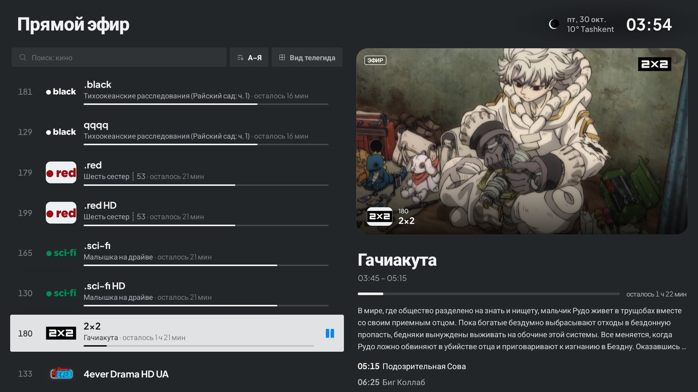</p>

## Возможности

**Источники**
- M3U / M3U8 по ссылке или из файла, Xtream Codes, Stalker/Ministra; несколько плейлистов одновременно.
- Группы провайдера (`group-title`, `#EXTGRP`), избранное, недавно просмотренные, скрытие и переименование категорий.
- Добавление плейлиста с телефона по QR-коду через локальную сеть — без набора адреса пультом.

**Телегид и архив**
- XMLTV (`url-tvg`, `.xml`, `.xml.gz`), автоматическая привязка программы по названию канала, даже без `tvg-id`.
- Сетка передач по всем каналам, описание и «что дальше» прямо в списке каналов.
- Архив (catch-up) и перемотка эфира там, где их поддерживает провайдер.

**Плеер**
- Прямой эфир играет через **libVLC**: HLS, MPEG-TS, H.264/HEVC, чересстрочное видео 576i, MP2/AC-3 звук. Выбора движка в интерфейсе нет: он один.
- При обрыве потока — тихое переподключение, без перезапуска всего плеера. Скорость открытия канала на настоящих телевизорах пока не измерялась.
- Переключение каналов кнопками ▲▼ и CH±, список каналов и категории поверх эфира (картинка не прерывается).
- Предпросмотр канала прямо в списке, плавное открытие на весь экран.

**Интерфейс**
- Сделан под пульт: всё доступно стрелками и OK, фокус всегда виден.
- Тёмная и светлая темы, акцентный цвет, масштаб интерфейса, настраиваемые анимации.
- Профили, PIN-код на категории, резервные копии и синхронизация между телевизорами.
- Переводы интерфейса: 26 наборов строк (русский, английский, китайский и ещё около 20 языков, часть регионального варианта).

**Обновления**
- Приложение само находит новую версию в GitHub Releases, проверяет подпись и устанавливает её.
- Можно выключить, выбрать частоту проверки (при запуске / каждые 6 часов / раз в день) и время установки (в любое время / ночью).

## Что умеет SkMate и чем это подтверждено

Мы не ставим оценок другим приложениям: надёжных открытых источников по TiviMate и IPTV Smarters нет (в поиске в основном рекламные страницы), а полагаться на них мы не хотим. Ниже только то, что можно проверить в этом репозитории. «Тест» значит автоматический тест, который запускается в CI; «эмулятор» значит, что функцию вручную проверили на эмуляторе Android TV.

| Возможность | Чем подтверждена |
|---|---|
| Умный поиск: раскладка, транслит, опечатки | тест [`SmartSearchTest`](engine/core/src/test/java/tv/own/owntv/core/content/SmartSearchTest.kt), эмулятор |
| Зеркала каналов: сбой → копия из другого плейлиста | тест [`ChannelMirrorsTest`](engine/core/src/test/java/tv/own/owntv/core/live/ChannelMirrorsTest.kt), эмулятор |
| Лестница отката при сбое (повтор, другой формат `.ts` ⇄ `.m3u8`) | тест [`LiveLadderTest`](engine/player-core/src/test/java/tv/own/owntv/player/LiveLadderTest.kt) |
| Буфер растёт при слабой сети | тест [`StallMeterTest`](engine/player-core/src/test/java/tv/own/owntv/player/StallMeterTest.kt) |
| Автопривязка программы по названию (без `tvg-id`) | тест [`EpgMatcherTest`](engine/core/src/test/java/tv/own/owntv/core/epg/EpgMatcherTest.kt) |
| Гиды по умолчанию: из плейлиста, по провайдеру, общие | тест [`GuideDefaultsTest`](engine/core/src/test/java/tv/own/owntv/core/epg/GuideDefaultsTest.kt) |
| «Скрыть повторы» (одна ссылка у нескольких каналов) | тест [`FeedDedupeTest`](engine/core/src/test/java/tv/own/owntv/core/epg/FeedDedupeTest.kt), эмулятор |
| Сортировка каналов и подборки «Сейчас идёт» | тесты [`LiveSortTest`](engine/core/src/test/java/tv/own/owntv/core/live/LiveSortTest.kt), [`SmartPicksTest`](engine/core/src/test/java/tv/own/owntv/core/content/SmartPicksTest.kt), эмулятор |
| Адреса архива (catch-up) разных провайдеров | тест [`CatchupUrlTest`](engine/core/src/test/java/tv/own/owntv/core/epg/CatchupUrlTest.kt); само воспроизведение архива на устройстве не проверялось |
| Шифрованная резервная копия | инструментальные тесты [`BackupRoundTripTest`](engine/core/src/androidTest/java/tv/own/owntv/core/backup/BackupRoundTripTest.kt), [`BackupContainerTest`](engine/core/src/androidTest/java/tv/own/owntv/core/backup/BackupContainerTest.kt) |
| Картинка в картинке | эмулятор |
| Напоминания о передачах поверх любого экрана | эмулятор |
| Открытый исходный код (GPL-3.0), подписанные сборки | [`LICENSE`](LICENSE), [`release.yml`](.github/workflows/release.yml), контрольные суммы в релизе |

**Не проверено на настоящем телевизоре:** плавность и скорость на слабых приставках, мультивид, запись и таймшифт, воспроизведение архива. Они реализованы в коде, но мы не заявляем, что они работают на всех устройствах.

**Про Kodi (по его документации):** Kodi свободное ПО под GPL ([kodi.tv/about](https://kodi.tv/about/)); дополнение IPTV Simple Client читает M3U и XMLTV, поддерживает несколько пар «плейлист и гид» начиная с Kodi 20, гид в `.gz` и `.xz`, а архив зависит от провайдера ([kodi.wiki](https://kodi.wiki/view/Add-on:IPTV_Simple_Client), [исходный код](https://github.com/kodi-pvr/pvr.iptvsimple)). Поэтому список различий у нас намеренно короткий: у SkMate это Android-приложение для пульта с автоматикой телегида и откатами при сбоях, у Kodi универсальный медиацентр.

## Подробно о возможностях

### Плеер
Прямой эфир играет через один движок, **libVLC**. Выбора движка в настройках нет: когда-то было несколько, но в версии 0.1.0 остался один, и его настройки убрали. Интерфейс плеера один и тот же на всех экранах.

### Не бросает вас на мёртвом канале
- **Лестница отката.** Канал не открылся: пробуется другой формат (`.ts` ⇄ `.m3u8`), повтор с паузой, терпимый разбор потока. Только потом ошибка.
- **Зеркала каналов.** Если канал так и не открылся, приложение само включает его копию из другого плейлиста («Первый HD» → «Первый SD»), ближайшую по качеству, и сообщает об этом.
- **Молчащий сервер больше не вешает приложение.** Поток, который не отдал ни байта за 10 секунд, считается ошибкой, а не чёрным экраном навсегда.
- **Понятные ошибки.** Вместо технического «open timeout» — картинка, заголовок («Канал не отвечает», «Нет интернета», «Не удаётся показать видео») и кнопка «Повторить».
- **Слабая сеть.** Если картинка зависает три раза за две минуты, буфер сам растёт на 4 секунды (до 12), а через десять спокойных минут возвращается.
- **Лимит соединений провайдера** учитывается: приложение не открывает лишних потоков и не получает блокировку 509.

### Поиск, который понимает человека
- Находит в **любой раскладке** («ntktrfyfk» → «телеканал»), по **транслиту** («kino» → «кино», «toshkent» → «тошкент»), с **опечатками** («dsicovery»), по началу, середине и концу слова.
- Лучшие совпадения первыми: точное, по началу, по слову, подстрока, похожее.
- Ищет **не только каналы, но и передачи** по телепрограмме, а также фильмы и сериалы.
- Результат открывается сразу, а Назад возвращает в тот же раздел.

### Знает, что идёт прямо сейчас
- **«Сейчас идёт»**: спорт, кино, новости, детям: каналы, где это идёт в эту минуту, по телепрограмме.
- **Спорт-доска**: каналы по странам и видам спорта, поиск по передачам и каналам, сортировка по релевантности, времени, названию, каналу. Распознаёт русские каналы (Матч, Окко, Боец, Старт и другие), турецкие и английские.
- **Напоминания о передачах** показываются над любым экраном, даже если вы ищете другой канал.

### Телегид, который чинится сам
- XMLTV из нескольких источников, `.xml`, `.xml.gz`, смещение времени для канала и общее.
- **Автопривязка программы по названию канала**, даже когда в плейлисте нет `tvg-id`.
- **«Починить телегид»** одним нажатием подбирает программу каналам, у которых её нет, и говорит, сколько нашёл.
- **«Скрыть повторы»** находит каналы с одной и той же ссылкой и прячет все, кроме первого, с подтверждением; вернуть можно в настройках.
- Архив (catch-up) и перемотка: адреса архива разных провайдеров покрыты тестами, само воспроизведение на устройстве не проверялось.

### Каналы: порядок под вас
Сортировка: порядок провайдера, А–Я, Я–А, по номеру, недавние. Группы провайдера, свои категории, избранное, история, скрытие и переименование, ручной порядок.

### Плеер и управление
- **Картинка в картинке** в окне системы: кнопка Home сворачивает видео в угол, а не останавливает.
- Нижняя панель с иконками и подписями: телегид, история, избранное, звук, субтитры, формат, мини, только звук, таймер сна.
- **Мультивид**, **запись** эфира и **таймшифт** есть в коде, но на настоящем телевизоре не проверялись. Таймер сна, выбор звука и субтитров с запоминанием, внешние субтитры OpenSubtitles.
- **Информация о потоке** (кодек, разрешение, битрейт, декодер) и «отправить отчёт» одним нажатием.
- Номер канала с пульта, возврат на предыдущий канал.

### Всё под рукой на телевизоре
- **Добавление плейлиста с телефона по QR**: окно по центру, красная подсказка про Wi-Fi.
- **Профили с PIN**, детский режим, PIN на категории.
- **Шифрованная резервная копия** и перенос настроек между телевизорами по Wi-Fi.
- Интеграция с главным экраном Android TV (недавние эфиры, «продолжить просмотр»).
- Тёмная и светлая тема, масштаб интерфейса, настраиваемые анимации, переводы на 20+ языков, всё управляется пультом.

### Быстрая работа на любом Android-устройстве
- **Анимации подстраиваются сами.** На слабой приставке (мало памяти или ядер) приложение стартует без анимаций. Во время работы оно следит за плавностью кадров: если экран не успевает, анимации отключаются, а через 10 минут пробуются снова (максимум три раза за запуск). На нормальном устройстве анимации включены всегда. Решение запоминается, чтобы следующий запуск не начинался с рывков. Переключатель «Подстраиваться под устройство» есть в настройках, ручной выбор «Анимации вкл/выкл» и скорость остаются.
- **Лёгкий список.** Список постраничный (прокрутка не читает всю базу), логотипы кэшируются, поиск идёт по индексу.
- **Бережное обращение с памятью.** Видео и фоновые движки освобождаются, когда приложение уходит в фон; на слабых устройствах включается экономичный буфер.
- **Нативные сборки** для `arm64-v8a` и `armeabi-v7a` (старые 32-битные приставки тоже).

### Открытость
Исходный код открыт (GPL-3.0), подписанный APK собирается в GitHub Actions. Проверка VirusTotal: для v0.1.0 выполнена (ссылка ниже), для v2.0.0 пока нет, см. раздел «Проверка загрузки». Без рекламы, без аккаунта, без сбора данных.

Подробно о том, что проверено и как: [docs/COMPARISON.md](docs/COMPARISON.md).

## Скриншоты

| | |
|:-:|:-:|
|  | 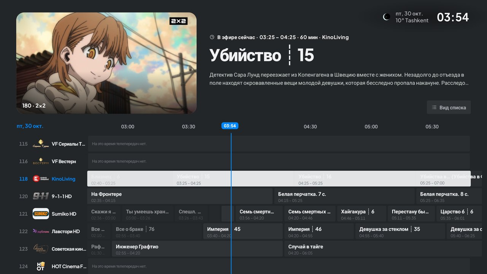 |
| **Прямой эфир**: список, предпросмотр, телепрограмма | **Телегид**: сетка передач по всем каналам |
| 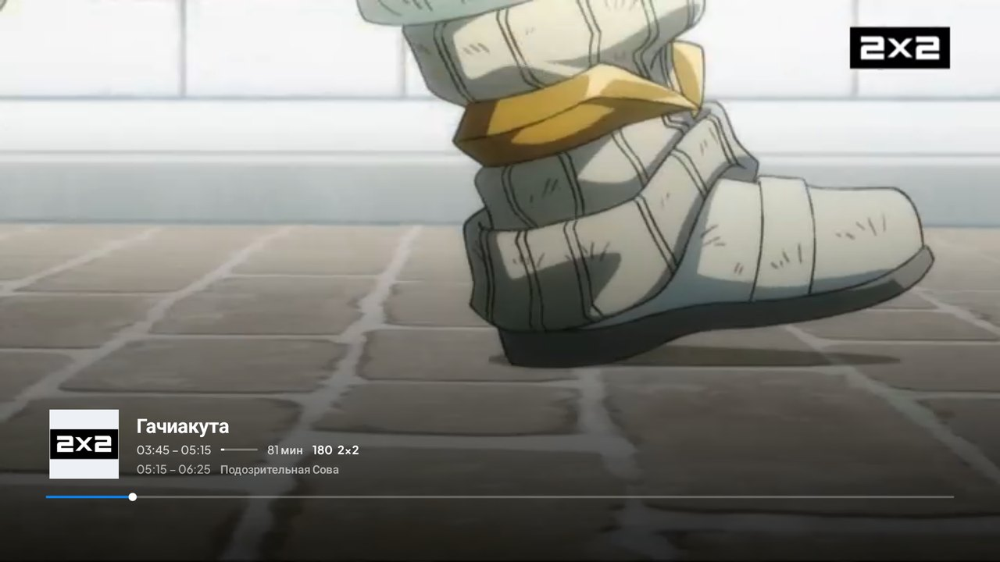 | 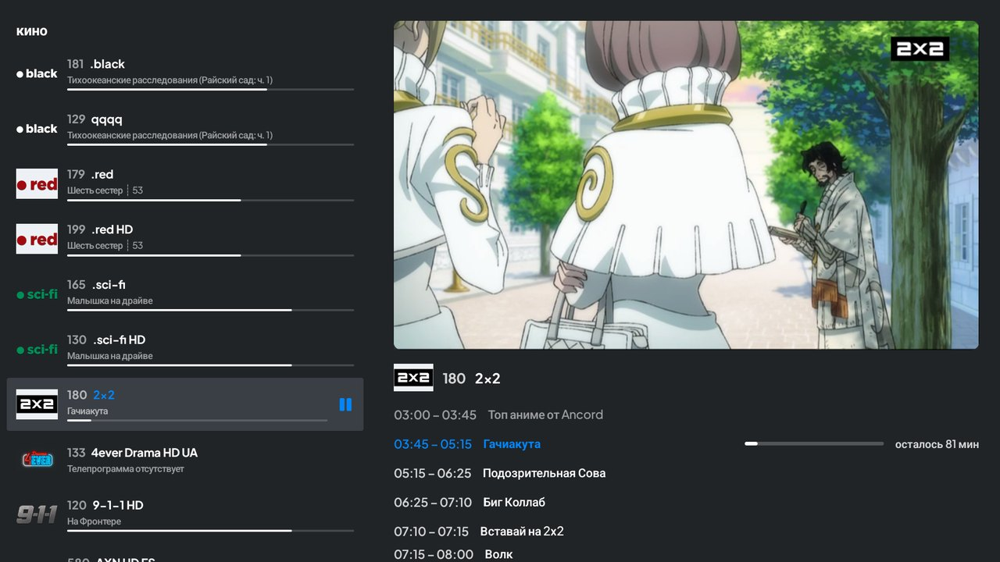 |
| **Плеер**: передача, время, прогресс, что дальше | **Каналы поверх эфира** с расписанием канала |
| 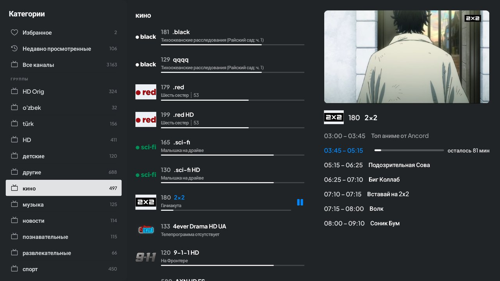 | 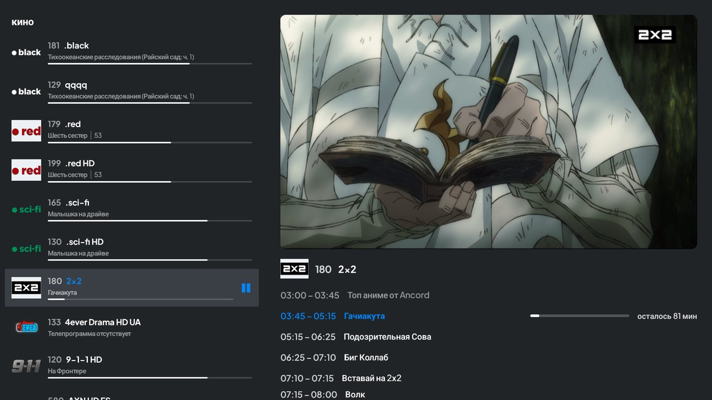 |
| **Категории в плеере**, картинка не прерывается | **Категории** в списке каналов |
| 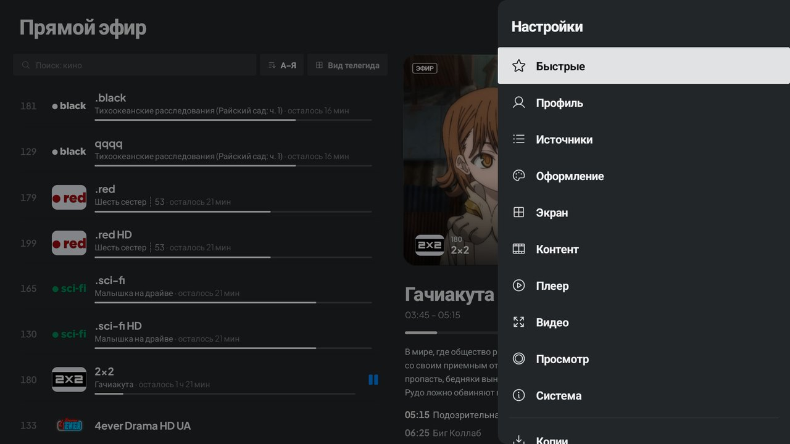 | 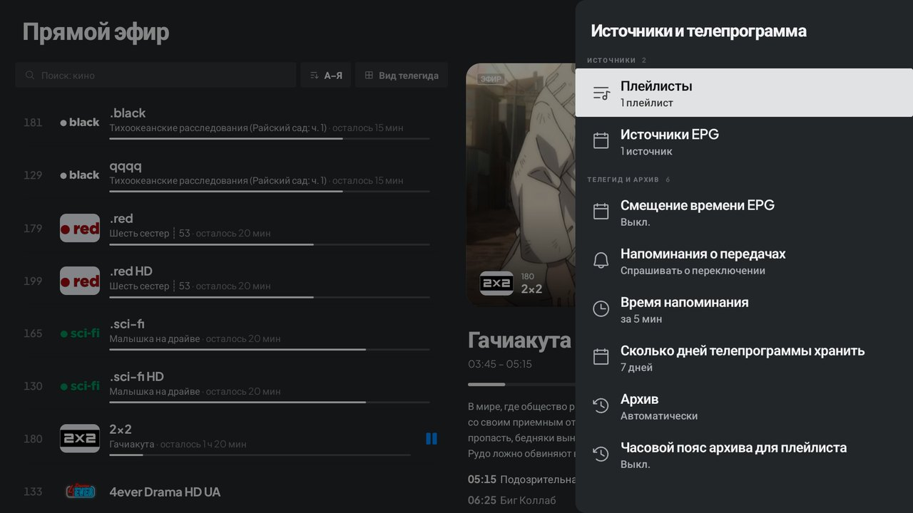 |
| **Настройки** — боковая панель поверх эфира | **Источники и телепрограмма (EPG)**, архив |
| 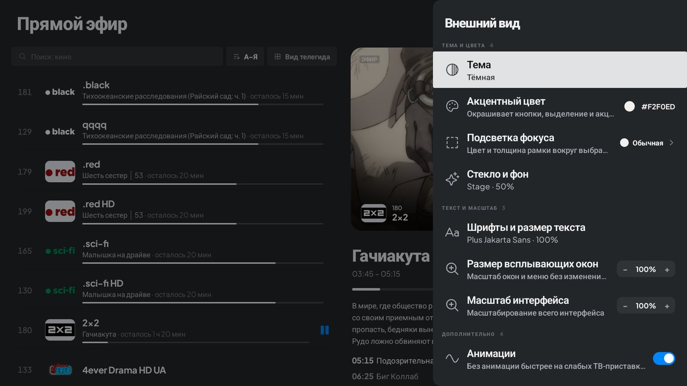 | 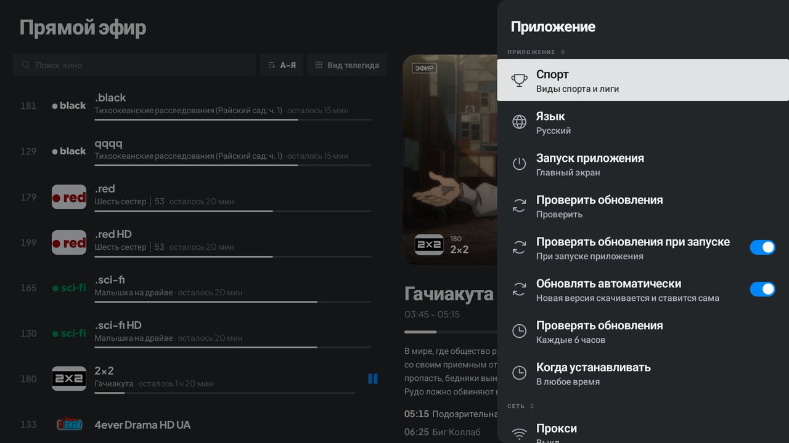 |
| **Оформление**: тема, акцент, масштаб, анимации | **Система**: язык, автообновление, расписание установки |
| 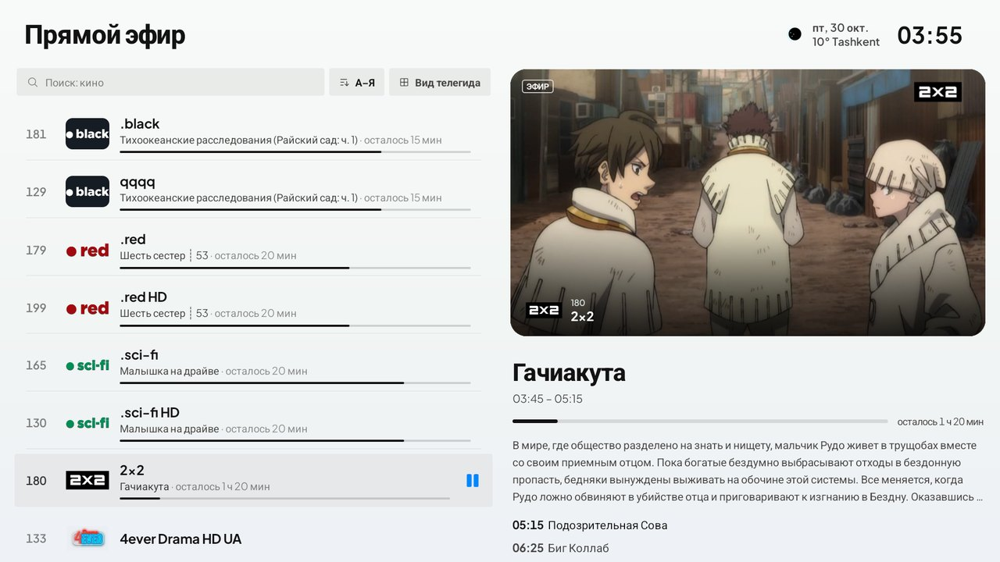 | 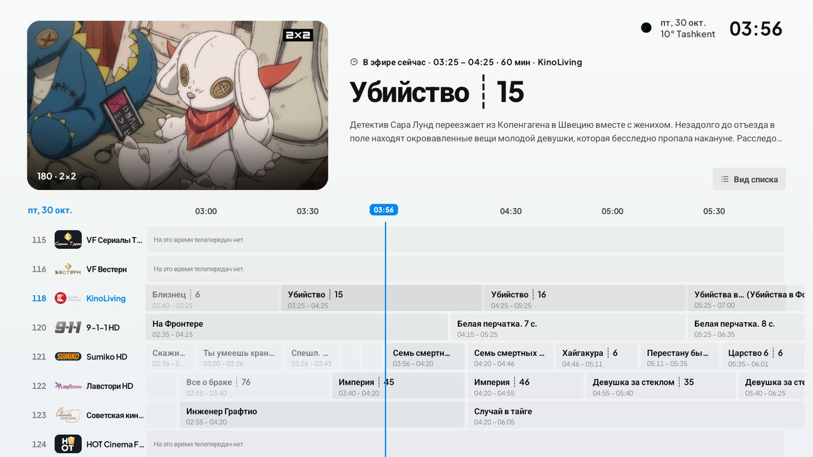 |
| **Светлая тема** | **Телегид в светлой теме** |

## Частые вопросы

**Это аналог TiviMate?** Да, это бесплатная альтернатива TiviMate с открытым кодом для Android TV, Google TV и Fire TV.
**Есть ли в приложении каналы?** Нет. Это только плеер: вы добавляете свой M3U, Xtream Codes или Stalker.
**Как добавить плейлист без набора адреса пультом?** Отсканируйте QR-код на телевизоре телефоном; телефон и ТВ должны быть в одной сети Wi-Fi.
**Какой нужен Android?** Android TV / Google TV 8.0 и новее, Fire TV, приставки на arm64-v8a и armeabi-v7a.

## Установка

1. Скачайте подписанный APK последней версии:
   **https://github.com/swensi17/skmate-iptv/releases/latest/download/SkMate-IPTV.apk**
2. На телевизоре удобно открыть эту ссылку в приложении **Downloader** (код можно ввести пультом).
3. Разрешите установку из этого источника и установите APK.
4. Добавьте плейлист: в приложении или с телефона по QR-коду.

Поддерживаются Android TV / Google TV 8.0+, Fire TV, ТВ-приставки на Android (arm64-v8a, armeabi-v7a).

## Безопасность

**v2.0.0.** Подписанные сборки собирает GitHub Actions ([`release.yml`](.github/workflows/release.yml)), подпись сверяется с ключом проекта. Контрольные суммы SHA-256 (те же лежат в релизе в `SHA256SUMS.txt`):

- arm: `3491eff933a78af0285bfec195357a50b02f65305458c8dd33e7b7352a7b8fd0`
- x86_64: `e5e62315962fcd0a7225280c5da9c5ead7f700498bfddc1f0bff2608cc2fc523`

**Проверка VirusTotal для v2.0.0 пока не выполнена.** Заранее готов workflow [`virustotal.yml`](.github/workflows/virustotal.yml): он отправляет APK релиза на проверку и пишет результат в отчёт запуска, но ему нужен ключ `VT_API_KEY` в секретах репозитория, и его ещё не запускали. Пока результата нет, никаких «0 угроз» для 2.0 мы не заявляем. Сверить файл можно и самому: скачайте APK, посчитайте `shasum -a 256` и сравните с суммой выше.

**v0.1.0.** Ссылка на APK релиза проверена на [VirusTotal](https://www.virustotal.com/gui/url/05d504ce01ad088e31df5fe963ef495adecafe4fdb005be10bb8738947c0ec53): 0 из 93 сканеров ничего не нашли. Это относится только к v0.1.0.

Суммы v0.1.0:

- arm: `e1041da56c2d1f69f3f7f84d5cd3bd64778a03b5f7b3f708855016cd0d608dcd`
- x86_64: `a9fd75fc7f98c11a6de5051ecad078a66036df0514ddb73a34813df017dbd181`

## О состоянии проекта

Проект молодой: репозиторий создан 30 октября 2026, звёзд и форков пока нет, независимых обзоров тоже. Если вы пользовались приложением, расскажите, как оно работает у вас, в [issues](https://github.com/swensi17/skmate-iptv/issues): и что хорошо, и что сломано. Таблицы сравнения с конкурентами мы не ведём, пока для них нет проверяемых источников.

## Сборка из исходников

Нужны JDK 21 и Android SDK (platform 37). Всё собирается из этого репозитория, токены и сторонние пакеты не нужны:

```bash
./gradlew :app:assembleStandardDebug
```

В репозитории: `app/` (приложение), `engine/` (ядро: разбор плейлистов, база, плееры), `libmpv/` (исходники и скрипты сборки libmpv), `libs/` (готовый libmpv).
Архитектура: [ARCHITECTURE.md](ARCHITECTURE.md) · участие: [CONTRIBUTING.md](CONTRIBUTING.md) · изменения: [CHANGELOG.md](CHANGELOG.md).

## Технологии

Kotlin · Jetpack Compose for TV · libVLC · Room · Koin · OkHttp · Coroutines/Flow · Coil.

## Ответственность за контент

SkMate IPTV — только плеер. Приложение не содержит и не предоставляет каналы, плейлисты или подписки. Пользователь сам отвечает за источники, которые добавляет.

Названия TiviMate, IPTV Smarters, Kodi и другие товарные знаки принадлежат их владельцам и используются только для сравнения функций; проект с ними не связан.

## Лицензия

[GPL-3.0-or-later](LICENSE). Уведомления об авторских правах — в [NOTICE](NOTICE), сторонние компоненты — в [THIRD_PARTY_LICENSES.md](THIRD_PARTY_LICENSES.md).

## Мы в сети

[Telegram](https://t.me/swensi17) · [X](https://x.com/swensi17) · [GitHub](https://github.com/swensi17)

<sub>Ключевые слова: IPTV player, Android TV, Google TV, Fire TV, M3U, M3U8, Xtream Codes, Stalker, EPG, XMLTV, catch-up, IPTV плеер, ТВ-приставка, телегид, IPTV 播放器, 电视直播.</sub>
