<p align="center">
  <picture>
    <source media="(prefers-color-scheme: dark)" srcset="docs/brand/banner-dark.png">
    
  </picture>
</p>

<h1 align="center">SkMate IPTV</h1>

<p align="center"><b>Бесплатный IPTV-плеер с открытым кодом для Android TV, Google TV, Fire TV, Windows, LG webOS и Samsung Tizen.</b><br>
M3U и Xtream Codes, телегид (EPG), архив, профили — управление только пультом, без рекламы и аккаунтов.</p>

<p align="center">
  <a href="https://github.com/swensi17/skmate-iptv/releases/latest"></a>
  <a href="https://github.com/swensi17/skmate-iptv/releases"></a>
  <a href="https://github.com/swensi17/skmate-iptv#%D0%B1%D0%B5%D0%B7%D0%BE%D0%BF%D0%B0%D1%81%D0%BD%D0%BE%D1%81%D1%82%D1%8C"></a>
  <a href="LICENSE"></a>
  <a href="https://github.com/swensi17/skmate-iptv/actions/workflows/build.yml"></a>
  <a href="https://github.com/swensi17/skmate-iptv/actions/workflows/web.yml"></a>
  <a href="https://github.com/swensi17/skmate-iptv/commits/main"></a>
  <a href="https://github.com/swensi17/skmate-iptv/commits/main"></a>
  <a href="https://github.com/swensi17/skmate-iptv/issues"></a>
</p>

<p align="center">
  
  
  
  
  
  
  <a href="https://swensi17.github.io/skmate-iptv/"></a>
</p>

<p align="center">
  
  
  
  
  
  
  
  
</p>

<p align="center">
  <a href="https://swensi17.github.io/skmate-iptv/"><b>▶ Демо веб-версии для LG webOS и Samsung Tizen</b></a> — открывается в браузере, управление стрелками, OK = Enter, «Назад» = Esc<br>
  <a href="https://github.com/swensi17/skmate-iptv/releases/latest"><b>⬇ SkMate IPTV для Windows</b></a> — установщик <code>SkMate-IPTV-Setup-X.Y.Z.exe</code> в последнем релизе, обновляется сам
</p>

<p align="center"><b>Русский</b> · <a href="docs/i18n-readme/README.en.md">English</a> · <a href="docs/i18n-readme/README.zh.md">中文</a></p>

<p align="center">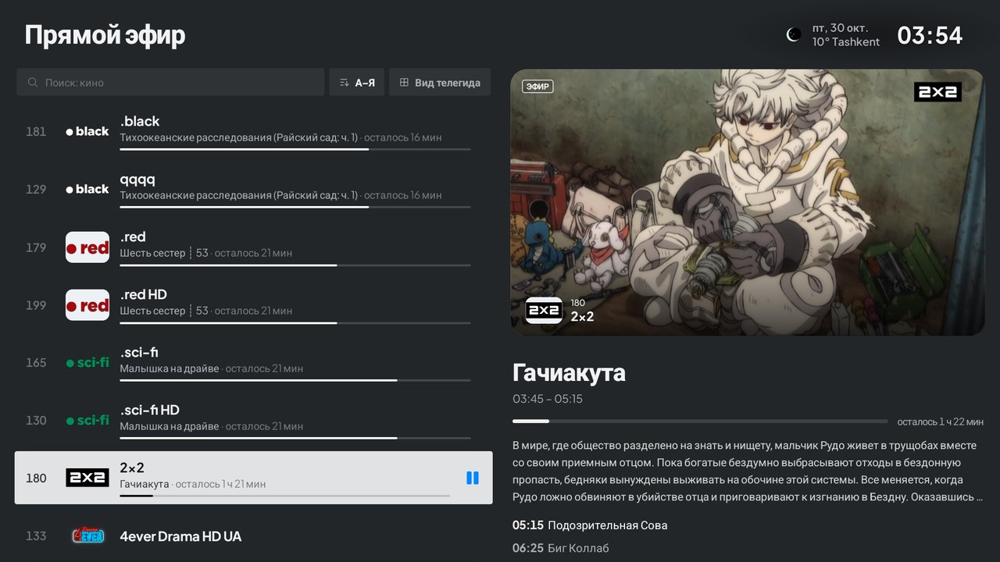</p>

## Возможности

**Источники**
- M3U / M3U8 по ссылке или из файла, Xtream Codes, Stalker/Ministra; несколько плейлистов одновременно.
- Группы провайдера (`group-title`, `#EXTGRP`), избранное, недавно просмотренные, скрытие и переименование категорий.
- Добавление плейлиста с телефона по QR-коду через локальную сеть — без набора адреса пультом.

**Телегид и архив**
- XMLTV (`url-tvg`, `.xml`, `.xml.gz`), автоматическая привязка программы по названию канала, даже без `tvg-id`.
- Сетка передач по всем каналам, описание и «что дальше» прямо в списке каналов.
- Архив (catch-up) и перемотка эфира там, где их поддерживает провайдер.

**Плеер**
- Прямой эфир играет через **libVLC**: HLS, MPEG-TS, H.264/HEVC, чересстрочное видео 576i, MP2/AC-3 звук. Выбора движка в интерфейсе нет: он один.
- При обрыве потока — тихое переподключение, без перезапуска всего плеера. Скорость открытия канала на настоящих телевизорах пока не измерялась.
- Переключение каналов кнопками ▲▼ и CH±, список каналов и категории поверх эфира (картинка не прерывается).
- Предпросмотр канала прямо в списке, плавное открытие на весь экран.

**Интерфейс**
- Сделан под пульт: всё доступно стрелками и OK, фокус всегда виден.
- Тёмная и светлая темы, акцентный цвет, масштаб интерфейса, настраиваемые анимации.
- Профили, PIN-код на категории, резервные копии и синхронизация между телевизорами.
- Переводы интерфейса: 26 наборов строк (русский, английский, китайский и ещё около 20 языков, часть регионального варианта).

**Обновления**
- Приложение само находит новую версию в GitHub Releases, проверяет подпись и устанавливает её.
- Можно выключить, выбрать частоту проверки (при запуске / каждые 6 часов / раз в день) и время установки (в любое время / ночью).

## Что есть на каждой платформе

✅ есть и работает · ❌ нет. Отметки сверены с кодом: если функция только отображается, но не работает (например, метка архива в веб-версии), стоит ❌.

| Функция | Android TV, Google TV, Fire TV | Windows | LG webOS, Samsung Tizen |
|---|:---:|:---:|:---:|
| Плейлист M3U / M3U8 по ссылке | ✅ | ✅ | ✅ |
| Плейлист M3U из файла | ✅ | ❌ | ❌ |
| Xtream Codes (сервер, логин, пароль) | ✅ | ✅ | ✅ |
| Stalker / Ministra (MAC-адрес) | ✅ | ❌ | ❌ |
| Несколько плейлистов сразу | ✅ | ✅ | ✅ |
| Телегид XMLTV (`.xml`, `.xml.gz`) | ✅ | ✅ | ✅ |
| Привязка телегида по названию канала, без `tvg-id` | ✅ | ✅ | ✅ |
| Сетка передач по всем каналам | ✅ | ✅ | ✅ |
| Воспроизведение архива (catch-up) | ✅ | ✅ | ✅ |
| Перемотка прямого эфира (таймшифт): пауза, ±30 с, «с начала», «в эфир» | ✅ | ✅² | ✅² |
| Умный поиск: любая раскладка, транслит, опечатки | ✅ | ✅ | ✅ |
| Поиск по передачам в телегиде | ✅ | ✅ | ✅ |
| Спорт: что идёт сейчас по видам спорта | ✅ | ✅ | ✅ |
| Избранное и недавно просмотренные | ✅ | ✅ | ✅ |
| Зеркала: сбой канала → копия из другого плейлиста | ✅ | ✅ | ✅ |
| Профили | ✅ | ✅ | ✅ |
| PIN на профиль и детский профиль (скрывает категории 18+) | ✅ | ✅ | ✅ |
| Резервная копия в файл | ✅ | ✅ | ✅ |
| Перенос на другой телевизор по Wi-Fi | ✅ | ❌ | ❌ |
| Плейлист с телефона по QR-коду | ✅ | ❌ | ❌ |
| Картинка в картинке | ✅ | ❌ | ❌ |
| Запись эфира | ✅ | ❌ | ❌ |
| Напоминания о передачах: спрашивать, переключать или только уведомлять | ✅ | ✅ | ✅ |
| Внешний плеер (VLC, MX Player и другие) | ✅ | ❌ | ❌ |
| Тёмная и светлая тема, масштаб интерфейса | ✅ | ✅ | ✅ |
| Языки интерфейса | 26 | 2 (русский, английский) | 2 (русский, английский) |
| Читает плейлисты с серверов без CORS | ✅ | ✅ | ❌ (браузер не даёт) |
| Обновляется сама | ✅ | ✅ | ✅ на веб-адресе, ❌ из пакета `.ipk` / `.wgt` |
| Без рекламы, без аккаунта, без сбора данных | ✅ | ✅ | ✅ |

Запись, таймшифт и картинка в картинке на Android TV реализованы, но на всех телевизорах не проверялись (см. ниже).

² На Windows, LG и Samsung эфир перематывается в пределах окна, которое отдаёт сам провайдер (HLS, `.m3u8`): браузер не может записывать поток на диск, как Android. «С начала передачи» берётся из архива провайдера, у каналов с архивом. Проверено на HLS-потоках в браузере; для потоков `.ts` и на настоящих телевизорах LG и Samsung пока не проверено.

Каждый ❌ мы убираем по этапам, чтобы всё работало одинаково на всех платформах. План и состояние: [docs/PARITY.md](docs/PARITY.md).

## Сравнение с популярными плеерами

В таблице только то, что сами приложения пишут в своих официальных источниках: на своих сайтах, в Google Play, App Store, на GitHub. «—» значит, что в официальном источнике об этом ничего нет. Это не обязательно означает, что функции нет. Источники собраны 1 ноября 2026 года и перечислены под таблицей. У SkMate каждая отметка проверяема в этом репозитории.

| | SkMate IPTV | TiviMate | IPTV Smarters Pro | Kodi + IPTV Simple | Sparkle TV | VLC |
|---|---|---|---|---|---|---|
| Платформы | Android TV, Google TV, Fire TV, Windows, LG, Samsung, браузер | Android TV | Android, Fire TV, Windows, macOS, LG, Samsung, браузер, iOS (отдельное приложение) | Windows, Linux, Android, macOS, iOS, tvOS, webOS | Android TV, Google TV, Fire TV | Windows, Linux, macOS, Android, iOS, Apple TV |
| Всё бесплатно | ✅ | ❌ премиум платный | ❌ часть функций в премиуме | ✅ | ❌ Plus от $1.49 в месяц | ✅ |
| Открытый код | ✅ GPL-3.0 | — | — | ✅ GPL | — | ✅ GPL / LGPL |
| Без рекламы | ✅ | — | — | — | — | ✅ |
| M3U | ✅ | ✅ | ✅ | ✅ | ✅ | ✅ |
| Xtream Codes | ✅ | ✅ | ✅ | ❌ только адреса архива | ✅ | — |
| Stalker / MAC-портал | ✅ Android | ✅ | — | — | ✅ | — |
| Телегид XMLTV | ✅ | ✅ | ✅ | ✅ | ✅ | — |
| Телегид без `tvg-id` (по названию) | ✅ | — | — | ✅ | — | — |
| Архив (catch-up) | ✅ | ✅ | ✅ | ✅ | ✅ в Plus | — |
| Перемотка эфира (таймшифт) | ✅ | — | — | ✅ | ✅ в Plus | ✅ |
| Запись эфира | ✅ Android | ✅ | — | — | ✅ в Plus | ✅ |
| Мультивид | ✅ Android¹ | ✅ | — | — | ✅ в Plus | — |
| Резервная копия канала из другого плейлиста при сбое | ✅ | — | — | — | — | — |
| Умный поиск: раскладка, транслит, опечатки | ✅ | — | — | — | — | — |
| Профили | ✅ | — | ✅ | ✅ | — | — |
| Родительский контроль | ✅ PIN профиля, детский профиль скрывает 18+ | ✅ | ✅ в премиуме | ✅ PIN | ✅ защита настроек | — |
| Языки интерфейса | 26 (Android) | — | — | — | — | 48 (iOS) |

¹ Реализовано, на всех телевизорах ещё не проверено.

**Где мы пока не лучше:**
- VLC переведён на 48 языков, у SkMate 26 (только Android).
- Kodi работает на Linux, macOS, iOS и tvOS, у SkMate этих версий нет.
- Запись, мультивид и Stalker у SkMate пока есть только на Android.

Всё это в плане [docs/PARITY.md](docs/PARITY.md).

<details><summary>Источники</summary>

- TiviMate: [Google Play](https://play.google.com/store/apps/details?id=ar.tvplayer.tv), [tivimate.com](https://tivimate.com/)
- IPTV Smarters Pro: [официальный сайт, копия на archive.org от 15.08.2026](https://web.archive.org/web/20260815103748/https://www.iptvsmarters.com/), [Smarters Player Lite в App Store](https://apps.apple.com/us/app/smarters-player-lite/id1628995509)
- Kodi: [загрузки, копия на archive.org](https://web.archive.org/web/20261030060155/https://kodi.tv/download/), [исходный код Kodi](https://github.com/xbmc/xbmc), [IPTV Simple Client](https://github.com/kodi-pvr/pvr.iptvsimple)
- Sparkle TV: [sparkleplayer.com](https://www.sparkleplayer.com/), [Google Play](https://play.google.com/store/apps/details?id=se.hedekonsult.sparkle)
- VLC: [videolan.org](https://www.videolan.org/vlc/), [App Store](https://apps.apple.com/us/app/vlc-media-player/id650377962), [timeshift](https://wiki.videolan.org/Documentation:Modules/timeshift)

</details>

## Что умеет SkMate и чем это подтверждено

Как подтверждена каждая функция SkMate. «Тест» значит автоматический тест, который запускается в CI; «эмулятор» значит, что функцию вручную проверили на эмуляторе Android TV; «браузер» значит живую проверку веб-версии (она же Windows, LG и Samsung) с пультом на тестовом плейлисте.

| Возможность | Чем подтверждена |
|---|---|
| Умный поиск: раскладка, транслит, опечатки | тест [`SmartSearchTest`](engine/core/src/test/java/tv/own/owntv/core/content/SmartSearchTest.kt), эмулятор |
| Зеркала каналов: сбой → копия из другого плейлиста | тест [`ChannelMirrorsTest`](engine/core/src/test/java/tv/own/owntv/core/live/ChannelMirrorsTest.kt), эмулятор |
| Лестница отката при сбое (повтор, другой формат `.ts` ⇄ `.m3u8`) | тест [`LiveLadderTest`](engine/player-core/src/test/java/tv/own/owntv/player/LiveLadderTest.kt) |
| Буфер растёт при слабой сети | тест [`StallMeterTest`](engine/player-core/src/test/java/tv/own/owntv/player/StallMeterTest.kt) |
| Автопривязка программы по названию (без `tvg-id`) | тест [`EpgMatcherTest`](engine/core/src/test/java/tv/own/owntv/core/epg/EpgMatcherTest.kt) |
| Гиды по умолчанию: из плейлиста, по провайдеру, общие | тест [`GuideDefaultsTest`](engine/core/src/test/java/tv/own/owntv/core/epg/GuideDefaultsTest.kt) |
| «Скрыть повторы» (одна ссылка у нескольких каналов) | тест [`FeedDedupeTest`](engine/core/src/test/java/tv/own/owntv/core/epg/FeedDedupeTest.kt), эмулятор |
| Сортировка каналов и подборки «Сейчас идёт» | тесты [`LiveSortTest`](engine/core/src/test/java/tv/own/owntv/core/live/LiveSortTest.kt), [`SmartPicksTest`](engine/core/src/test/java/tv/own/owntv/core/content/SmartPicksTest.kt), эмулятор |
| Адреса архива (catch-up) разных провайдеров | тест [`CatchupUrlTest`](engine/core/src/test/java/tv/own/owntv/core/epg/CatchupUrlTest.kt) и те же случаи в веб-ядре [`catchup.test.ts`](web/packages/core/src/catchup.test.ts) |
| Архив в веб-версии: телегид, поиск, перемотка ±30 с, «В эфир» | браузер, тестовый плейлист с `catchup="append"`; на Android TV у провайдера с архивом не проверялось |
| Таймшифт в веб-версии: пауза эфира и продолжение с того же места, ±30 с, «с начала», «в эфир» | тест [`timeshift.test.ts`](web/packages/core/src/timeshift.test.ts), браузер на живом HLS-потоке (после паузы картинка продолжилась с того же места, ← отвёл ещё на 30 с, «в эфир» вернул к эфиру: часы в кадре отстают на 8 с, обычная задержка потока) |
| PIN профиля и детский профиль в веб-версии | тест [`parental.test.ts`](web/packages/core/src/parental.test.ts) (случаи классификатора с Android, хеш PIN совпадает с форматом Android), браузер: детский режим скрыл категорию «Для взрослых» в списке и поиске, PIN спрошен при запуске, при смене профиля, при выключении детского режима; неверный PIN и «Назад» не открывают профиль |
| Напоминания о передачах в веб-версии | тест [`reminders.test.ts`](web/packages/core/src/reminders.test.ts) (случаи `ReminderScheduleTest` с Android), браузер: «Напомнить» из телегида, окно «Скоро начнётся» поверх плеера за 1 минуту до начала, «Смотреть» переключил канал; режимы «Переключать» и «Только уведомлять» |
| Шифрованная резервная копия | инструментальные тесты [`BackupRoundTripTest`](engine/core/src/androidTest/java/tv/own/owntv/core/backup/BackupRoundTripTest.kt), [`BackupContainerTest`](engine/core/src/androidTest/java/tv/own/owntv/core/backup/BackupContainerTest.kt) |
| Картинка в картинке | эмулятор |
| Напоминания о передачах поверх любого экрана | эмулятор (Android), браузер (веб-версия) |
| Открытый исходный код (GPL-3.0), подписанные сборки | [`LICENSE`](LICENSE), [`release.yml`](.github/workflows/release.yml), контрольные суммы в релизе |

**Не проверено на настоящем телевизоре:** плавность и скорость на слабых приставках, мультивид, запись и таймшифт, воспроизведение архива. Они реализованы в коде, но мы не заявляем, что они работают на всех устройствах.

**Про Kodi (по его документации):** Kodi свободное ПО под GPL ([kodi.tv/about](https://kodi.tv/about/)); дополнение IPTV Simple Client читает M3U и XMLTV, поддерживает несколько пар «плейлист и гид» начиная с Kodi 20, гид в `.gz` и `.xz`, а архив зависит от провайдера ([kodi.wiki](https://kodi.wiki/view/Add-on:IPTV_Simple_Client), [исходный код](https://github.com/kodi-pvr/pvr.iptvsimple)). Поэтому список различий у нас намеренно короткий: у SkMate это Android-приложение для пульта с автоматикой телегида и откатами при сбоях, у Kodi универсальный медиацентр.

## Подробно о возможностях

### Плеер
Прямой эфир играет через один движок, **libVLC**. Выбора движка в настройках нет: когда-то было несколько, но в версии 0.1.0 остался один, и его настройки убрали. Интерфейс плеера один и тот же на всех экранах.

### Не бросает вас на мёртвом канале
- **Лестница отката.** Канал не открылся: пробуется другой формат (`.ts` ⇄ `.m3u8`), повтор с паузой, терпимый разбор потока. Только потом ошибка.
- **Зеркала каналов.** Если канал так и не открылся, приложение само включает его копию из другого плейлиста («Первый HD» → «Первый SD»), ближайшую по качеству, и сообщает об этом.
- **Молчащий сервер больше не вешает приложение.** Поток, который не отдал ни байта за 10 секунд, считается ошибкой, а не чёрным экраном навсегда.
- **Понятные ошибки.** Вместо технического «open timeout» — картинка, заголовок («Канал не отвечает», «Нет интернета», «Не удаётся показать видео») и кнопка «Повторить».
- **Слабая сеть.** Если картинка зависает три раза за две минуты, буфер сам растёт на 4 секунды (до 12), а через десять спокойных минут возвращается.
- **Лимит соединений провайдера** учитывается: приложение не открывает лишних потоков и не получает блокировку 509.

### Поиск, который понимает человека
- Находит в **любой раскладке** («ntktrfyfk» → «телеканал»), по **транслиту** («kino» → «кино», «toshkent» → «тошкент»), с **опечатками** («dsicovery»), по началу, середине и концу слова.
- Лучшие совпадения первыми: точное, по началу, по слову, подстрока, похожее.
- Ищет **не только каналы, но и передачи** по телепрограмме, а также фильмы и сериалы.
- Результат открывается сразу, а Назад возвращает в тот же раздел.

### Знает, что идёт прямо сейчас
- **«Сейчас идёт»**: спорт, кино, новости, детям: каналы, где это идёт в эту минуту, по телепрограмме.
- **Спорт-доска**: каналы по странам и видам спорта, поиск по передачам и каналам, сортировка по релевантности, времени, названию, каналу. Распознаёт русские каналы (Матч, Окко, Боец, Старт и другие), турецкие и английские.
- **Напоминания о передачах** показываются над любым экраном, даже если вы ищете другой канал.

### Телегид, который чинится сам
- XMLTV из нескольких источников, `.xml`, `.xml.gz`, смещение времени для канала и общее.
- **Автопривязка программы по названию канала**, даже когда в плейлисте нет `tvg-id`.
- **«Починить телегид»** одним нажатием подбирает программу каналам, у которых её нет, и говорит, сколько нашёл.
- **«Скрыть повторы»** находит каналы с одной и той же ссылкой и прячет все, кроме первого, с подтверждением; вернуть можно в настройках.
- Архив (catch-up) и перемотка: адреса архива разных провайдеров покрыты тестами, само воспроизведение на устройстве не проверялось.

### Каналы: порядок под вас
Сортировка: порядок провайдера, А–Я, Я–А, по номеру, недавние. Группы провайдера, свои категории, избранное, история, скрытие и переименование, ручной порядок.

### Плеер и управление
- **Картинка в картинке** в окне системы: кнопка Home сворачивает видео в угол, а не останавливает.
- Нижняя панель с иконками и подписями: телегид, история, избранное, звук, субтитры, формат, мини, только звук, таймер сна.
- **Мультивид**, **запись** эфира и **таймшифт** есть в коде, но на настоящем телевизоре не проверялись. Таймер сна, выбор звука и субтитров с запоминанием, внешние субтитры OpenSubtitles.
- **Информация о потоке** (кодек, разрешение, битрейт, декодер) и «отправить отчёт» одним нажатием.
- Номер канала с пульта, возврат на предыдущий канал.

### Всё под рукой на телевизоре
- **Добавление плейлиста с телефона по QR**: окно по центру, красная подсказка про Wi-Fi.
- **Профили с PIN**, детский режим, PIN на категории.
- **Шифрованная резервная копия** и перенос настроек между телевизорами по Wi-Fi.
- Интеграция с главным экраном Android TV (недавние эфиры, «продолжить просмотр»).
- Тёмная и светлая тема, масштаб интерфейса, настраиваемые анимации, переводы на 20+ языков, всё управляется пультом.

### Быстрая работа на любом Android-устройстве
- **Анимации подстраиваются сами.** На слабой приставке (мало памяти или ядер) приложение стартует без анимаций. Во время работы оно следит за плавностью кадров: если экран не успевает, анимации отключаются, а через 10 минут пробуются снова (максимум три раза за запуск). На нормальном устройстве анимации включены всегда. Решение запоминается, чтобы следующий запуск не начинался с рывков. Переключатель «Подстраиваться под устройство» есть в настройках, ручной выбор «Анимации вкл/выкл» и скорость остаются.
- **Лёгкий список.** Список постраничный (прокрутка не читает всю базу), логотипы кэшируются, поиск идёт по индексу.
- **Бережное обращение с памятью.** Видео и фоновые движки освобождаются, когда приложение уходит в фон; на слабых устройствах включается экономичный буфер.
- **Нативные сборки** для `arm64-v8a` и `armeabi-v7a` (старые 32-битные приставки тоже).

### Открытость
Исходный код открыт (GPL-3.0), подписанный APK собирается в GitHub Actions. Проверка VirusTotal: для v0.1.0 выполнена (ссылка ниже), для v2.0.0 пока нет, см. раздел «Проверка загрузки». Без рекламы, без аккаунта, без сбора данных.

Подробно о том, что проверено и как: [docs/COMPARISON.md](docs/COMPARISON.md).

## Скриншоты

| | |
|:-:|:-:|
|  | 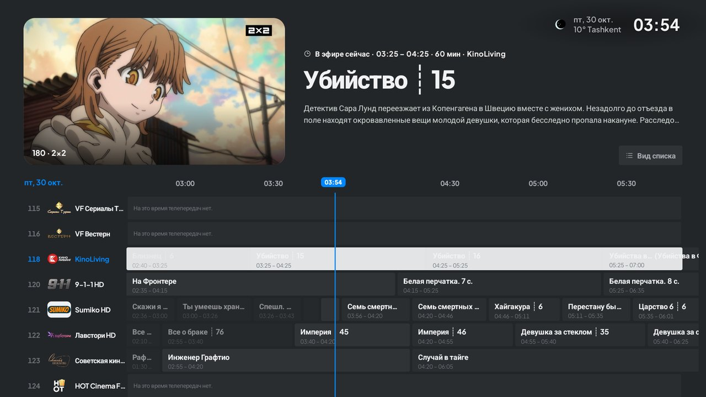 |
| **Прямой эфир**: список, предпросмотр, телепрограмма | **Телегид**: сетка передач по всем каналам |
| 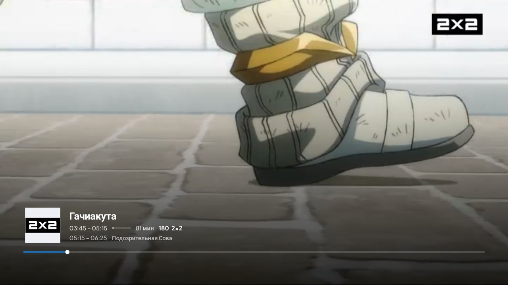 | 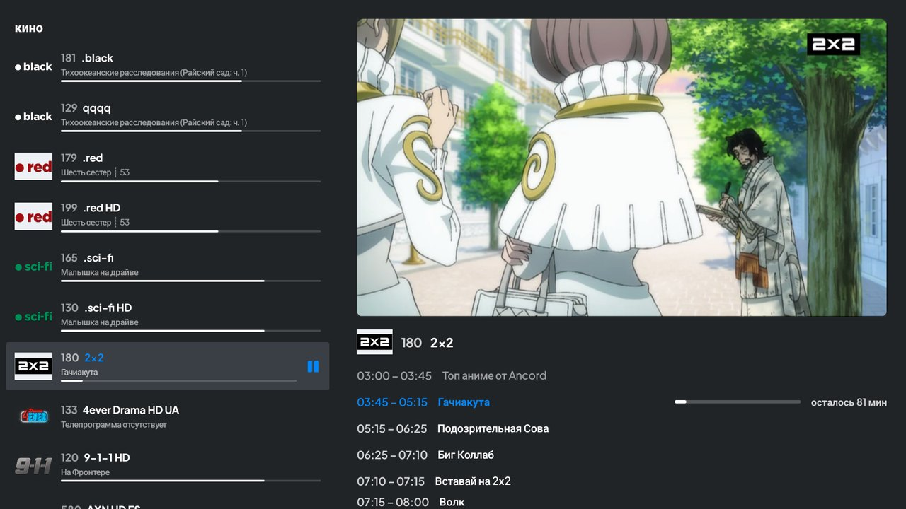 |
| **Плеер**: передача, время, прогресс, что дальше | **Каналы поверх эфира** с расписанием канала |
| 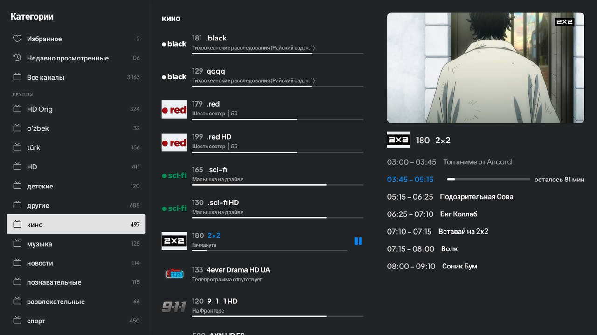 | 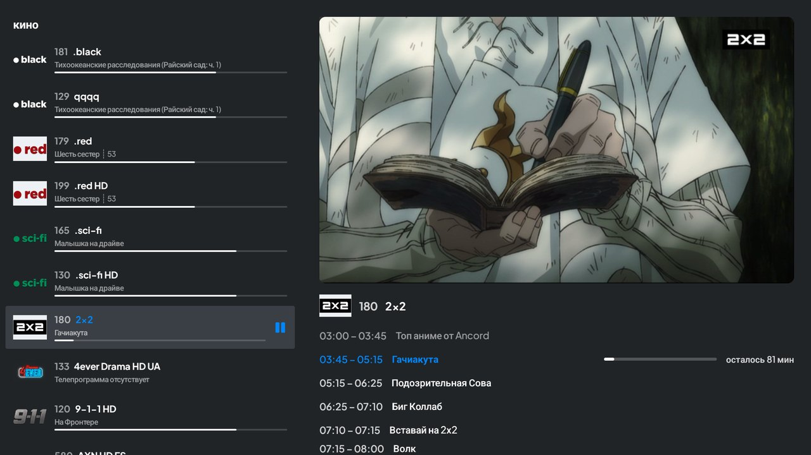 |
| **Категории в плеере**, картинка не прерывается | **Категории** в списке каналов |
| 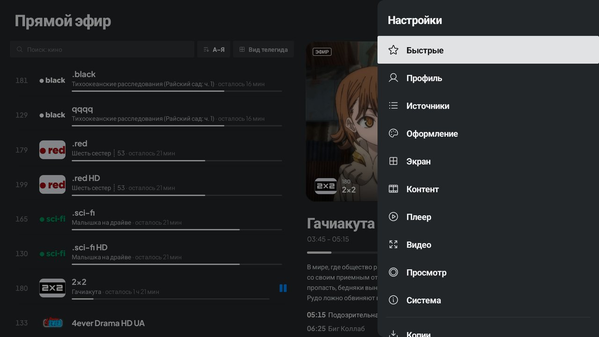 | 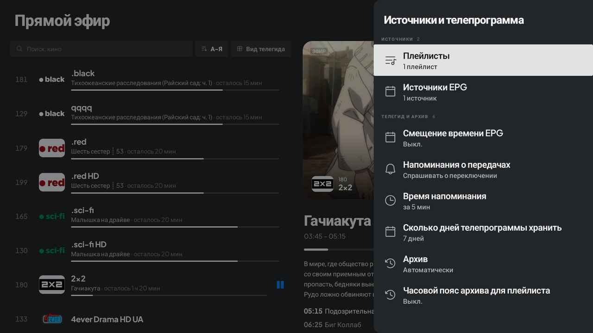 |
| **Настройки** — боковая панель поверх эфира | **Источники и телепрограмма (EPG)**, архив |
| 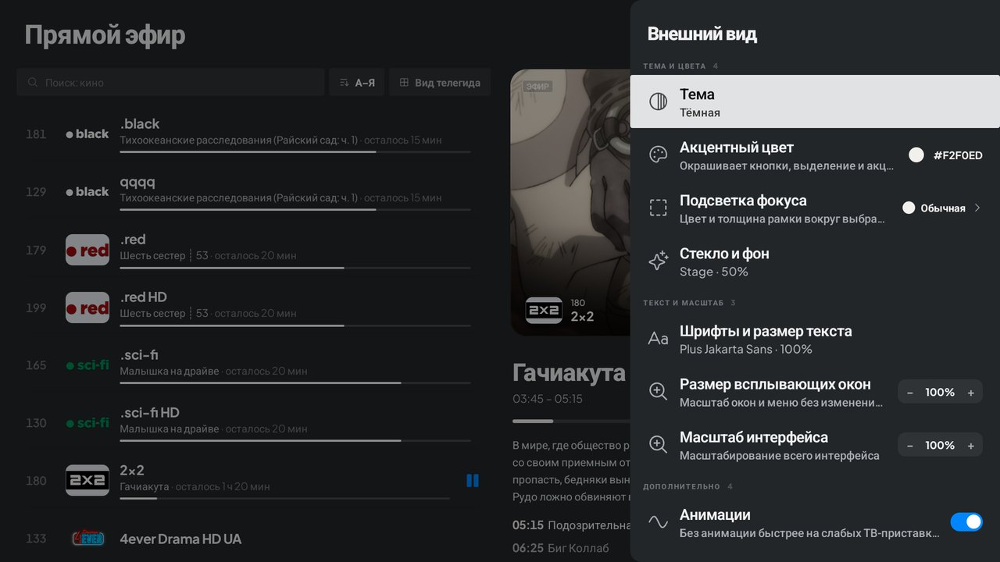 | 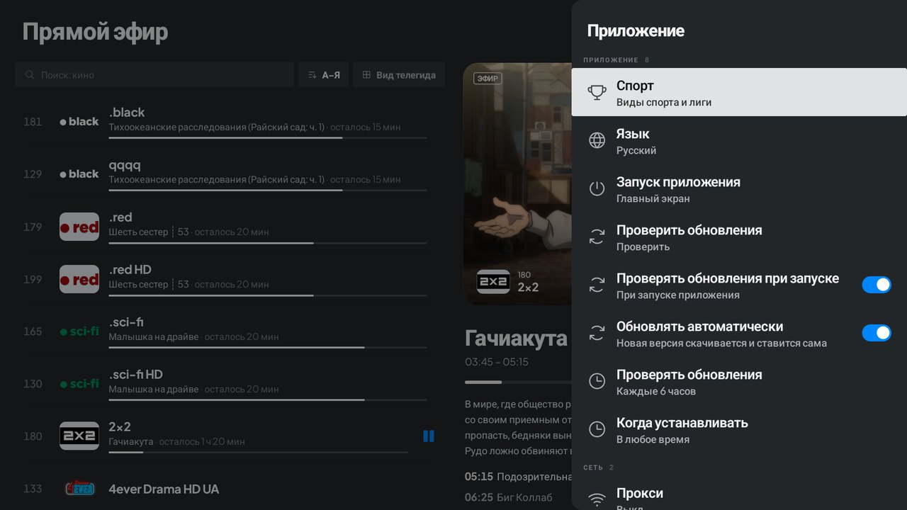 |
| **Оформление**: тема, акцент, масштаб, анимации | **Система**: язык, автообновление, расписание установки |
| 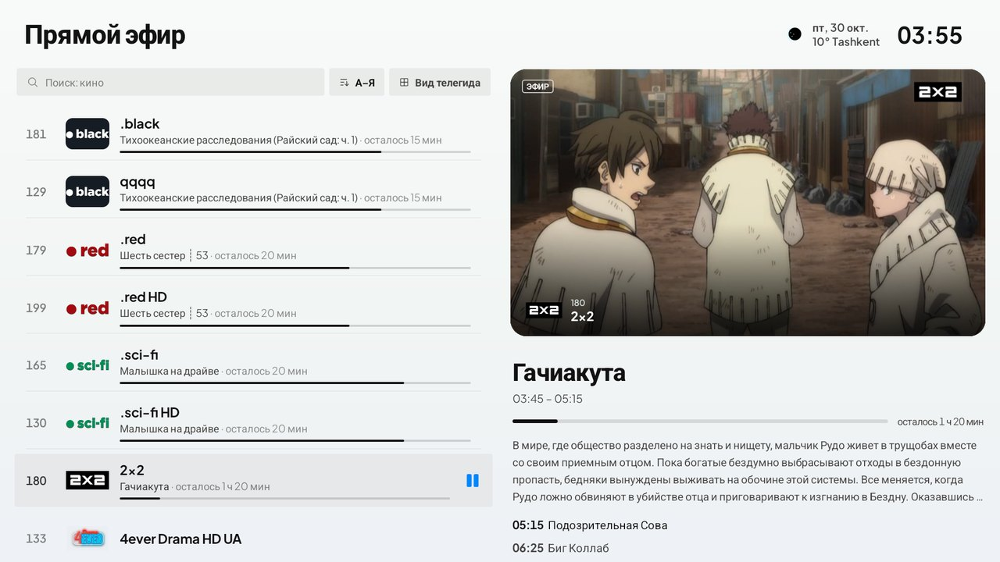 | 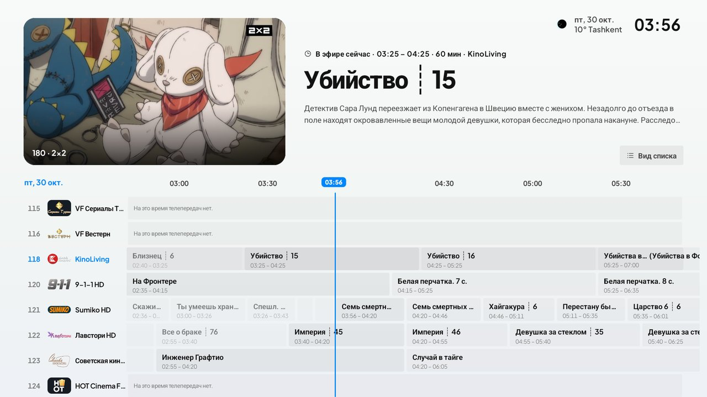 |
| **Светлая тема** | **Телегид в светлой теме** |

## Частые вопросы

**Это аналог TiviMate?** Да, это бесплатная альтернатива TiviMate с открытым кодом для Android TV, Google TV и Fire TV.
**Есть ли в приложении каналы?** Нет. Это только плеер: вы добавляете свой M3U, Xtream Codes или Stalker.
**Как добавить плейлист без набора адреса пультом?** Отсканируйте QR-код на телевизоре телефоном; телефон и ТВ должны быть в одной сети Wi-Fi.
**Какой нужен Android?** Android TV / Google TV 8.0 и новее, Fire TV, приставки на arm64-v8a и armeabi-v7a.

## Установка

1. Скачайте подписанный APK последней версии:
   **https://github.com/swensi17/skmate-iptv/releases/latest/download/SkMate-IPTV.apk**
2. На телевизоре удобно открыть эту ссылку в приложении **Downloader** (код можно ввести пультом).
3. Разрешите установку из этого источника и установите APK.
4. Добавьте плейлист: в приложении или с телефона по QR-коду.

Поддерживаются Android TV / Google TV 8.0+, Fire TV, ТВ-приставки на Android (arm64-v8a, armeabi-v7a).

## Безопасность

### Проверка VirusTotal: v2.2.3

Файлы выпуска [v2.2.3](https://github.com/swensi17/skmate-iptv/releases/tag/v2.2.3) отправлены на [VirusTotal](https://www.virustotal.com) по ссылке на скачивание с GitHub: VirusTotal сам скачивает файл из релиза и проверяет его всеми антивирусами. Для установщика Windows и обеих APK ни один антивирус не нашёл угроз. Нажмите на отчёт, чтобы увидеть полный список антивирусов и дату проверки.

| Файл | Результат | Отчёт |
|---|---|---|
| `SkMate-IPTV-Setup-2.2.3.exe` (Windows) | ✅ 0 из 68 | [открыть](https://www.virustotal.com/gui/file/e6ee399665b8f34d3bccb1faa19768ccd4e7383b434524bcecbbba801573a4cd) |
| `SkMate-IPTV-v2.2.3-arm.apk` (Android TV) | ✅ 0 из 67 | [открыть](https://www.virustotal.com/gui/file/bf29972ea044d05a6b810e24d433ff06168e0a96c8e9996a45949381cdeef93f) |
| `SkMate-IPTV-v2.2.3-x86_64.apk` | ✅ 0 из 67 | [открыть](https://www.virustotal.com/gui/file/f39d6c0602dc6ed97f34fe0e8b47b95d9d879ed229a7941c150434c8270de209) |

Пакеты для телевизоров (`.ipk`, `.wgt`, `.zip`) содержат тот же веб-код, что открыт в [демо](https://swensi17.github.io/skmate-iptv/). Их проверка на VirusTotal не завершена: сайт запросил капчу. Начатые отчёты: [`.wgt`](https://www.virustotal.com/gui/file/a86076ec6a174a18dd48115d53d17e3751d88fe58c9a7629f3291220a201d8fb), [`.zip`](https://www.virustotal.com/gui/file/08576d9ebe52c23895ee7753cb08a12e8befd8f8a8679b265ffc24b120cf03a1). Пока проверка не закончена, «0 угроз» для них мы не заявляем.

«0 из 68» значит: 68 антивирусов проверили файл, ни один не счёл его опасным. Остальные движки VirusTotal не умеют разбирать этот тип файла и в счёт не входят.

### Почему Windows и браузер всё равно предупреждают

- **Установщик Windows не подписан сертификатом разработчика** (он платный). Поэтому при первом запуске SmartScreen пишет «Windows защитила ваш компьютер»: это значит «издатель неизвестен», а не «найден вирус». Нажмите «Подробнее» → «Выполнить в любом случае».
- **APK ставится не из Google Play**, поэтому Android один раз просит разрешить установку из этого источника. Все версии подписаны одним ключом проекта: приложение принимает обновление, только если подпись совпадает.

### Как проверить файл самому

1. Скачайте файл из [релиза](https://github.com/swensi17/skmate-iptv/releases/latest).
2. Посчитайте сумму: `shasum -a 256 <файл>` (macOS, Linux) или `certutil -hashfile <файл> SHA256` (Windows).
3. Сравните с `SHA256SUMS.txt` в релизе и с суммами ниже. Совпала: файл тот же, что собрал GitHub Actions.

Суммы SHA-256 v2.2.3:

```
e6ee399665b8f34d3bccb1faa19768ccd4e7383b434524bcecbbba801573a4cd  SkMate-IPTV-Setup-2.2.3.exe
bf29972ea044d05a6b810e24d433ff06168e0a96c8e9996a45949381cdeef93f  SkMate-IPTV-v2.2.3-arm.apk
f39d6c0602dc6ed97f34fe0e8b47b95d9d879ed229a7941c150434c8270de209  SkMate-IPTV-v2.2.3-x86_64.apk
14fed87c3410952f15642abe38356af51a9c832259546c8e798b5022a9c2ad8e  uz.skmate.iptv_2.2.3_all.ipk
a86076ec6a174a18dd48115d53d17e3751d88fe58c9a7629f3291220a201d8fb  SkMate-IPTV-tizen-v2.2.3.wgt
08576d9ebe52c23895ee7753cb08a12e8befd8f8a8679b265ffc24b120cf03a1  SkMate-IPTV-web-v2.2.3.zip
```

### Откуда берутся файлы

Все файлы выпуска собирает GitHub Actions из открытого кода этого репозитория ([`release.yml`](.github/workflows/release.yml)), а не компьютер разработчика. Журнал каждой сборки открыт во вкладке [Actions](https://github.com/swensi17/skmate-iptv/actions/workflows/release.yml). Приложение не показывает рекламу, не требует аккаунта и не отправляет данные о просмотре: код можно прочитать целиком.

## О состоянии проекта

Проект молодой: репозиторий создан 30 октября 2026, звёзд и форков пока нет, независимых обзоров тоже. Если вы пользовались приложением, расскажите, как оно работает у вас, в [issues](https://github.com/swensi17/skmate-iptv/issues): и что хорошо, и что сломано. Таблицы сравнения с конкурентами мы не ведём, пока для них нет проверяемых источников.

## Сборка из исходников

Нужны JDK 21 и Android SDK (platform 37). Всё собирается из этого репозитория, токены и сторонние пакеты не нужны:

```bash
./gradlew :app:assembleStandardDebug
```

В репозитории: `app/` (приложение), `engine/` (ядро: разбор плейлистов, база, плееры), `libmpv/` (исходники и скрипты сборки libmpv), `libs/` (готовый libmpv).
Архитектура: [ARCHITECTURE.md](ARCHITECTURE.md) · участие: [CONTRIBUTING.md](CONTRIBUTING.md) · изменения: [CHANGELOG.md](CHANGELOG.md).

## Технологии

Kotlin · Jetpack Compose for TV · libVLC · Room · Koin · OkHttp · Coroutines/Flow · Coil.

## Ответственность за контент

SkMate IPTV — только плеер. Приложение не содержит и не предоставляет каналы, плейлисты или подписки. Пользователь сам отвечает за источники, которые добавляет.

Названия TiviMate, IPTV Smarters, Kodi и другие товарные знаки принадлежат их владельцам и используются только для сравнения функций; проект с ними не связан.

## Лицензия

[GPL-3.0-or-later](LICENSE). Уведомления об авторских правах — в [NOTICE](NOTICE), сторонние компоненты — в [THIRD_PARTY_LICENSES.md](THIRD_PARTY_LICENSES.md).

## Мы в сети

[Telegram](https://t.me/swensi17) · [X](https://x.com/swensi17) · [GitHub](https://github.com/swensi17)

<sub>Ключевые слова: IPTV player, Android TV, Google TV, Fire TV, M3U, M3U8, Xtream Codes, Stalker, EPG, XMLTV, catch-up, IPTV плеер, ТВ-приставка, телегид, IPTV 播放器, 电视直播.</sub>
