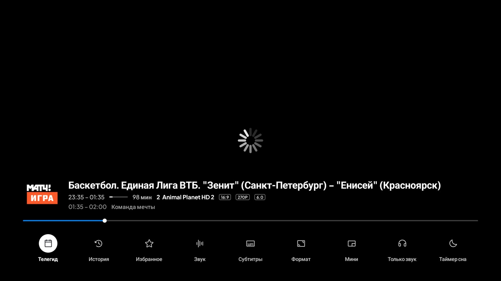
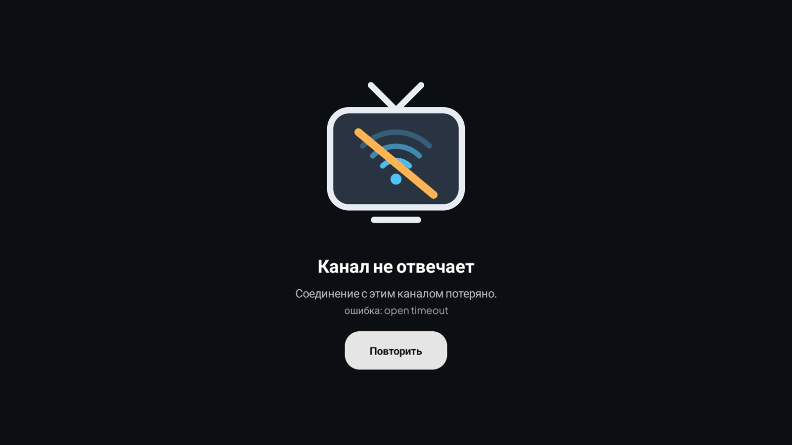
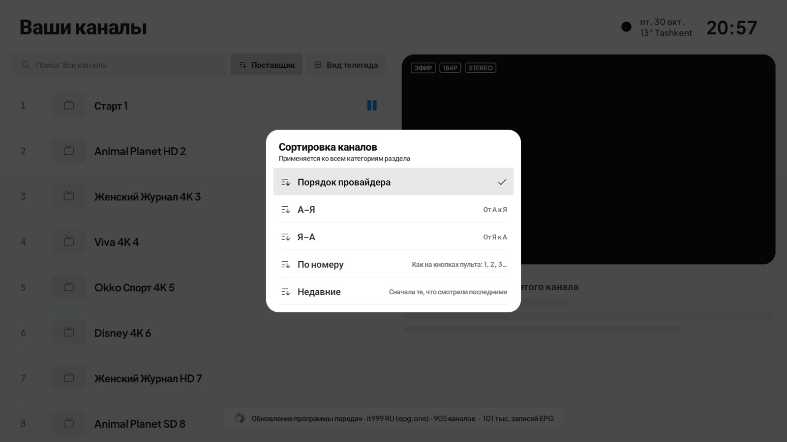
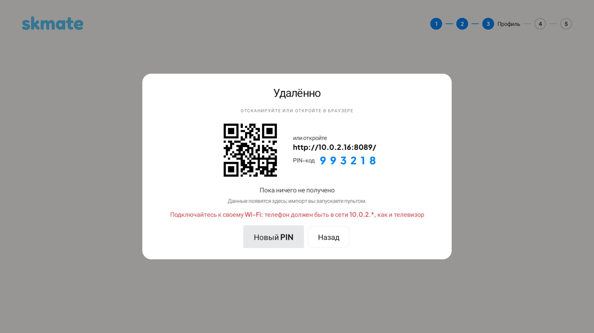

<p align="center">
  <picture>
    <source media="(prefers-color-scheme: dark)" srcset="../../docs/brand/banner-dark.png">
    
  </picture>
</p>

<h1 align="center">SkMate IPTV</h1>

<p align="center"><b>A free, open-source IPTV player for Android TV, Google TV and Fire TV.</b><br>
M3U and Xtream Codes, TV guide (EPG), catch-up, profiles — built for the remote, no ads, no accounts.</p>

<p align="center">
  <a href="https://github.com/swensi17/skmate-iptv/releases/latest"></a>
  <a href="https://github.com/swensi17/skmate-iptv/releases"></a>
  <a href="../../LICENSE"></a>
  
  
  
</p>

<p align="center"><a href="../../README.md">Русский</a> · <b>English</b> · <a href="README.zh.md">中文</a></p>

<p align="center"></p>

## Features

**Sources**
- M3U / M3U8 from a URL or a file, Xtream Codes, Stalker/Ministra; several playlists at once.
- Provider groups (`group-title`, `#EXTGRP`), favourites, recently watched, hide and rename categories.
- Add a playlist from your phone with a QR code over the local network — no typing with the remote.

**TV guide and catch-up**
- XMLTV (`url-tvg`, `.xml`, `.xml.gz`) with automatic matching by channel name, even without `tvg-id`.
- A programme grid for every channel; description and "up next" right in the channel list.
- Catch-up and live rewind where the provider supports them.

**Player**
- One **libVLC** engine: HLS, MPEG-TS, H.264/HEVC, interlaced 576i, MP2/AC-3 audio.
- Channels open in about a second; a dropped stream reconnects quietly instead of restarting the player.
- Zap with ▲▼ and CH±, channel list and categories over the picture (playback never stops).
- Live preview in the list and a smooth expand to full screen.

**Interface**
- Made for the remote: everything works with the arrows and OK, focus is always visible.
- Dark and light themes, accent colour, interface scale, adjustable animations.
- Profiles, category PIN lock, backups and sync between TVs.
- Interface languages: Russian, English, Chinese and 20+ more.

**Updates**
- The app finds a new version on GitHub Releases, verifies its signature and installs it.
- Can be turned off; choose how often to check (at start / every 6 hours / daily) and when to install (any time / at night).

## What's new in 2.0 (`main`, release in preparation)

| | |
|:-:|:-:|
|  |  |
| **Player toolbar**: icon and caption on every button | **Plain error screen** instead of technical text |
|  |  |
| **Sorting**: provider order, A–Z, Z–A, by number, recent | **Add a playlist from your phone**, Wi-Fi hint |

- **Smart search**: any keyboard layout, transliteration, typos, programme search.
- **Sports board** by country and sport, **"On now"** lists (sport, movies, news, kids).
- **Channel mirrors**: a channel that will not open switches to its copy from another playlist.
- **"Fix the guide"**, **hide repeats**, channel sorting, weak-network mode.
- **Picture-in-picture**, reminders, one dark player, uniform square buttons, smooth panels.

## How SkMate compares with other IPTV players

| | SkMate IPTV | TiviMate | IPTV Smarters | Kodi |
|---|:-:|:-:|:-:|:-:|
| Free, no ads | ✅ | ❌ paid Premium | ⚠️ | ✅ |
| Open source | ✅ | ❌ | ❌ | ✅ |
| Smart search (layout, typos, programmes) | ✅ | ⚠️ | ⚠️ | ⚠️ |
| Auto fail-over to a channel's mirror | ✅ | — | — | — |
| Sports board and "On now" | ✅ | — | — | — |
| One-click guide repair, duplicate hiding | ✅ | — | — | — |
| Buffer adapts to a weak network | ✅ | — | — | — |
| Catch-up, reminders, PIN profiles | ✅ | ✅ | ⚠️ | ⚠️ |

Full comparison and caveats: [COMPARISON.md](../COMPARISON.md). We do not claim SkMate is smoother than TiviMate on low-end boxes: on-device measurements are still to come.

## FAQ

**Is this a TiviMate alternative?** Yes: a free, open-source alternative for Android TV, Google TV and Fire TV.
**Does it include channels?** No. It is only a player: you add your own M3U, Xtream Codes or Stalker source.
**How do I add a playlist without typing with the remote?** Scan the QR code on the TV with your phone; both must be on the same Wi-Fi.

## Screenshots

| | |
|:-:|:-:|
|  |  |
| **Live TV**: list, live preview, programme info | **TV guide**: programme grid for every channel |
|  |  |
| **Player**: now, time, progress, up next | **Channels over the picture** with the channel schedule |
|  |  |
| **Categories in the player**, the picture keeps playing | **Categories** in the channel list |
|  |  |
| **Settings** — side sheet over live TV | **Sources and TV guide (EPG)**, catch-up |
|  |  |
| **Appearance**: theme, accent, scale, motion | **System**: language, auto-update, install window |
|  |  |
| **Light theme** | **TV guide in the light theme** |

## Install

1. Download the latest signed APK:
   **https://github.com/swensi17/skmate-iptv/releases/latest/download/SkMate-IPTV.apk**
2. On a TV, open the link in the **Downloader** app.
3. Allow installs from that source and install the APK.
4. Add a playlist in the app or from your phone via QR code.

Runs on Android TV / Google TV 8.0+, Fire TV and Android set-top boxes (arm64-v8a, armeabi-v7a).

## Security

The v0.1.0 release APK link was checked on [VirusTotal](https://www.virustotal.com/gui/url/05d504ce01ad088e31df5fe963ef495adecafe4fdb005be10bb8738947c0ec53): **0 of 93** scanners flagged anything. The source code is open and builds run in GitHub Actions. SHA-256 checksums are in the release (`SHA256SUMS.txt`):

- arm: `e1041da56c2d1f69f3f7f84d5cd3bd64778a03b5f7b3f708855016cd0d608dcd`
- x86_64: `a9fd75fc7f98c11a6de5051ecad078a66036df0514ddb73a34813df017dbd181`

## Build from source

JDK 21 and Android SDK (platform 37). Everything builds from this repository, no tokens or third-party package registries needed:

```bash
./gradlew :app:assembleStandardDebug
```

In the repository: `app/` (the app), `engine/` (core: playlist parsing, database, players), `libmpv/` (libmpv sources and build scripts), `libs/` (prebuilt libmpv).

## Tech stack

Kotlin · Jetpack Compose for TV · libVLC · Room · Koin · OkHttp · Coroutines/Flow · Coil.

## Content disclaimer

SkMate IPTV is a player only. It does not include or provide channels, playlists or subscriptions. Users are responsible for the sources they add.

## License

[GPL-3.0-or-later](../../LICENSE). Copyright notices: [NOTICE](../../NOTICE). Third-party components: [THIRD_PARTY_LICENSES.md](../../THIRD_PARTY_LICENSES.md).

## Links

[Telegram](https://t.me/swensi17) · [X](https://x.com/swensi17) · [GitHub](https://github.com/swensi17)
