<p align="center">
  <picture>
    <source media="(prefers-color-scheme: dark)" srcset="../../docs/brand/banner-dark.png">
    
  </picture>
</p>

<h1 align="center">SkMate IPTV</h1>

<p align="center"><b>A free, open-source IPTV player for Android TV, Google TV, Fire TV, Windows, LG webOS and Samsung Tizen.</b><br>
M3U and Xtream Codes, TV guide (EPG), catch-up, profiles — built for the remote, no ads, no accounts.</p>

<p align="center">
  <a href="https://github.com/swensi17/skmate-iptv/releases/latest"></a>
  <a href="https://github.com/swensi17/skmate-iptv/releases"></a>
  <a href="https://github.com/swensi17/skmate-iptv/blob/main/docs/i18n-readme/README.en.md#security"></a>
  <a href="../../LICENSE"></a>
  <a href="https://github.com/swensi17/skmate-iptv/actions/workflows/build.yml"></a>
  <a href="https://github.com/swensi17/skmate-iptv/actions/workflows/web.yml"></a>
  <a href="https://github.com/swensi17/skmate-iptv/commits/main"></a>
  <a href="https://github.com/swensi17/skmate-iptv/commits/main"></a>
  <a href="https://github.com/swensi17/skmate-iptv/issues"></a>
</p>

<p align="center">
  
  
  
  
  
  
  <a href="https://swensi17.github.io/skmate-iptv/"></a>
</p>

<p align="center">
  
  
  
  
  
  
  
  
</p>

<p align="center"><a href="../../README.md">Русский</a> · <b>English</b> · <a href="README.zh.md">中文</a></p>

<p align="center">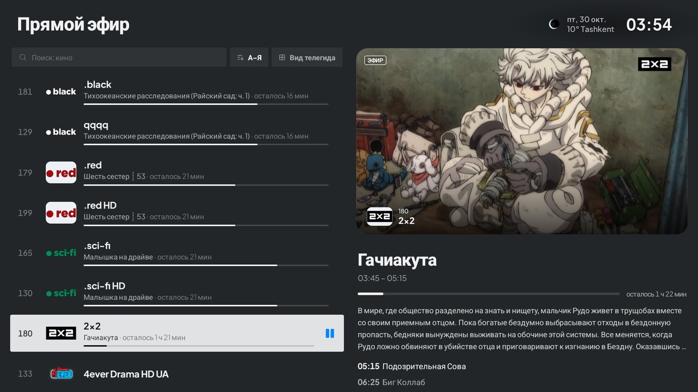</p>

## Features

**Sources**
- M3U / M3U8 from a URL or a file, Xtream Codes, Stalker/Ministra; several playlists at once.
- Provider groups (`group-title`, `#EXTGRP`), favourites, recently watched, hide and rename categories.
- Add a playlist from your phone with a QR code over the local network — no typing with the remote.

**TV guide and catch-up**
- XMLTV (`url-tvg`, `.xml`, `.xml.gz`) with automatic matching by channel name, even without `tvg-id`.
- A programme grid for every channel; description and "up next" right in the channel list.
- Catch-up and live rewind where the provider supports them.

**Player**
- Live TV plays through **libVLC**: HLS, MPEG-TS, H.264/HEVC, interlaced 576i, MP2/AC-3 audio. There is no engine picker in the interface: there is one engine.
- Channels open in about a second; a dropped stream reconnects quietly instead of restarting the player.
- Zap with ▲▼ and CH±, channel list and categories over the picture (playback never stops).
- Live preview in the list and a smooth expand to full screen.

**Interface**
- Made for the remote: everything works with the arrows and OK, focus is always visible.
- Dark and light themes, accent colour, interface scale, adjustable animations.
- Profiles, category PIN lock, backups and sync between TVs.
- Interface translations: 26 string sets (Russian, English, Chinese and about 20 more languages, some as regional variants).

**Updates**
- The app finds a new version on GitHub Releases, verifies its signature and installs it.
- Can be turned off; choose how often to check (at start / every 6 hours / daily) and when to install (any time / at night).

## Rare features: what sets SkMate apart from other IPTV players

### Several players in one app
Live TV plays through a single engine, **libVLC**. There is no engine picker in the settings: there used to be several, but in 0.1.0 one was kept and the settings of the others were removed. The player interface is the same on every screen.

### It does not leave you on a dead channel
- **Fallback ladder**: another format (`.ts` ⇄ `.m3u8`), a retry after a pause, tolerant demuxing, and only then an error.
- **Channel mirrors**: a channel that still will not open switches to its copy from another playlist ("Channel HD" → "Channel SD"), closest in quality, and says so.
- **A silent server no longer freezes the app**: a stream that gives no byte in 10 seconds is an error, not a black screen forever.
- **Plain error screens** with a picture, a headline and a Retry button instead of technical text.
- **Weak network**: three stalls in two minutes deepen the buffer by 4 seconds (up to 12); ten quiet minutes bring it back.
- **The provider's connection limit** is respected.

### Search that understands people
Any keyboard layout, transliteration, typos, start / middle / end of a word, best matches first. It finds **programmes**, not only channels, plus movies and series.

### It knows what is on right now
**"On now"** (sport, movies, news, kids) from the guide; a **sports board** by country and sport that recognises Russian, Turkish and English sports channels; **reminders** that appear over any screen.

### A guide that repairs itself
Several XMLTV sources, automatic matching by channel name even without `tvg-id`, **"Fix the guide"** in one press, **"Hide repeats"** for channels with the same link, catch-up with an archive badge in the list and the guide.

### Your order
Sort by provider order, A–Z, Z–A, number, recent; groups, custom categories, favourites, history, hide and rename.

### Player and control
**Picture-in-picture** in the system window, a labelled toolbar, multiview, recording and timeshift (in the code, but not tested on a real TV), sleep timer, remembered audio and subtitle choices, OpenSubtitles, a stream-info overlay with a one-press report, direct channel numbers.

### Made for the TV
**Add a playlist from your phone by QR**, **PIN profiles** and a kids mode, an **encrypted backup** and transfer between TVs over Wi-Fi, Android TV home-screen integration, dark and light themes, **25+ languages**, fully remote-controlled.

### Fast on any Android device
- **Animations adapt on their own.** On a weak box (little memory or few cores) the app starts with animations off. While running it watches frame smoothness: if the screen cannot keep up, animations switch off and are tried again after 10 minutes (at most three times per launch). On a capable device they stay on. The decision is remembered so the next launch does not begin with stutter. An "Adapt to the device" switch is in Settings; the manual animations on/off and speed stay.
- **A light list.** 5,000+ channels are paged (scrolling does not read the whole database), logos are cached, search uses an index.
- **Careful with memory.** Video and background engines are released when the app goes to the background; a lean buffer is used on weak devices.
- **Native builds** for `arm64-v8a` and `armeabi-v7a` (older 32-bit boxes too).

### Open
GPL-3.0 source, a signed APK built in GitHub Actions. VirusTotal: v2.2.3 installer and APKs 0 detections, see "Security". No ads, no account, no data collection.

What is verified and how: [COMPARISON.md](../COMPARISON.md).

## FAQ

**Is this a TiviMate alternative?** Yes: a free, open-source alternative for Android TV, Google TV and Fire TV.
**Does it include channels?** No. It is only a player: you add your own M3U, Xtream Codes or Stalker source.
**How do I add a playlist without typing with the remote?** Scan the QR code on the TV with your phone; both must be on the same Wi-Fi.

## Screenshots

| | |
|:-:|:-:|
|  | 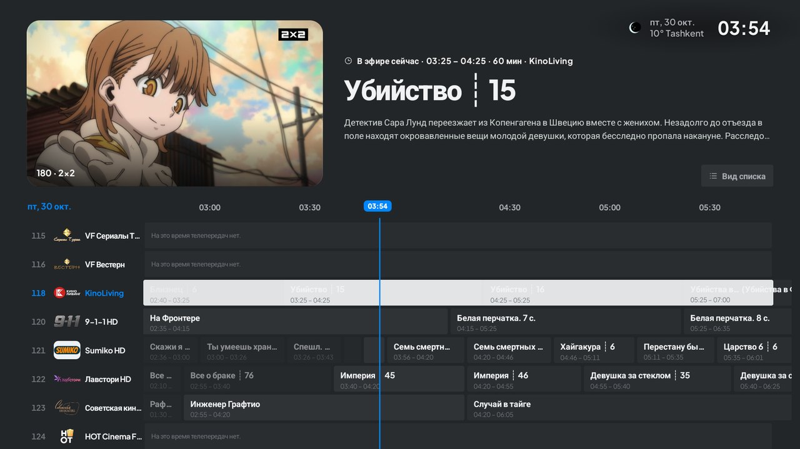 |
| **Live TV**: list, live preview, programme info | **TV guide**: programme grid for every channel |
| 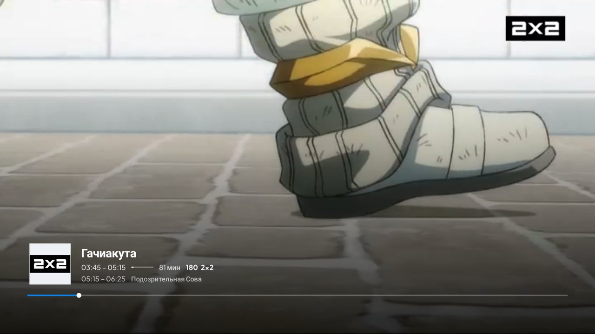 | 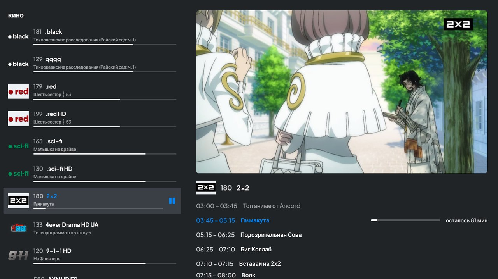 |
| **Player**: now, time, progress, up next | **Channels over the picture** with the channel schedule |
| 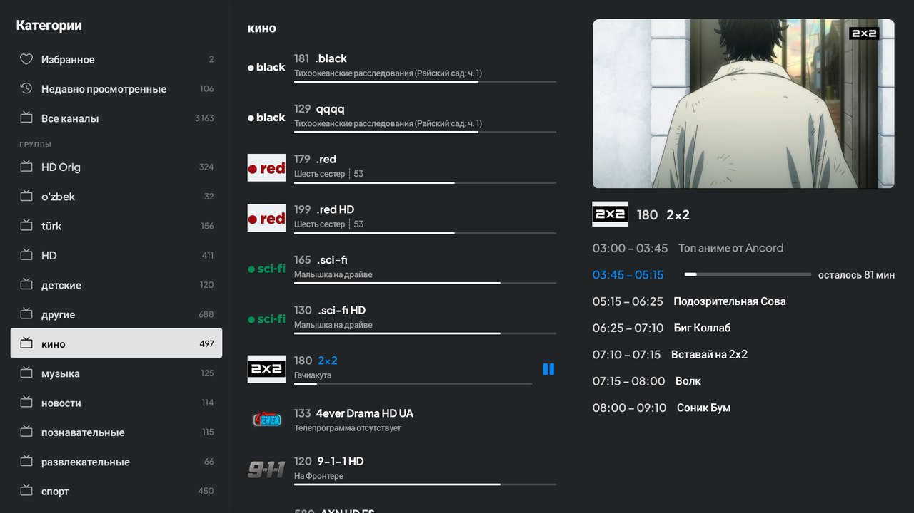 | 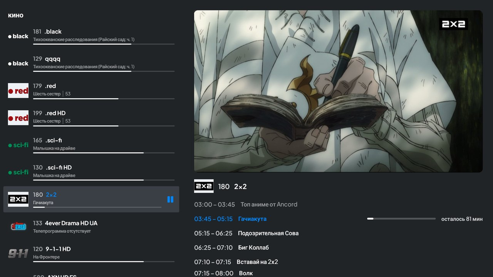 |
| **Categories in the player**, the picture keeps playing | **Categories** in the channel list |
| 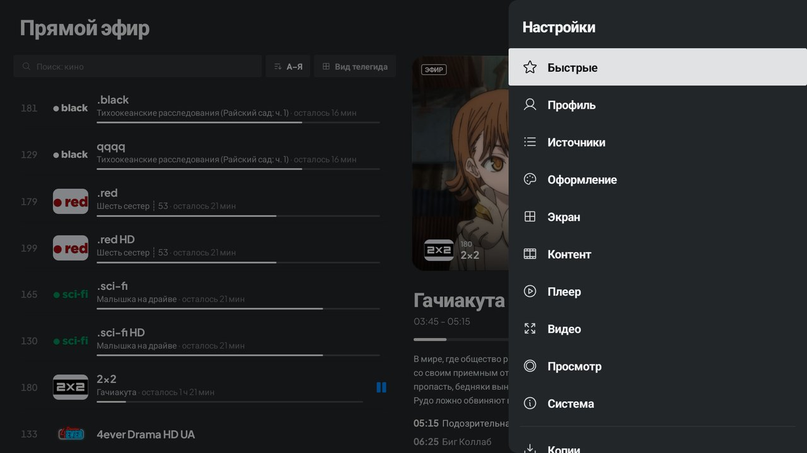 | 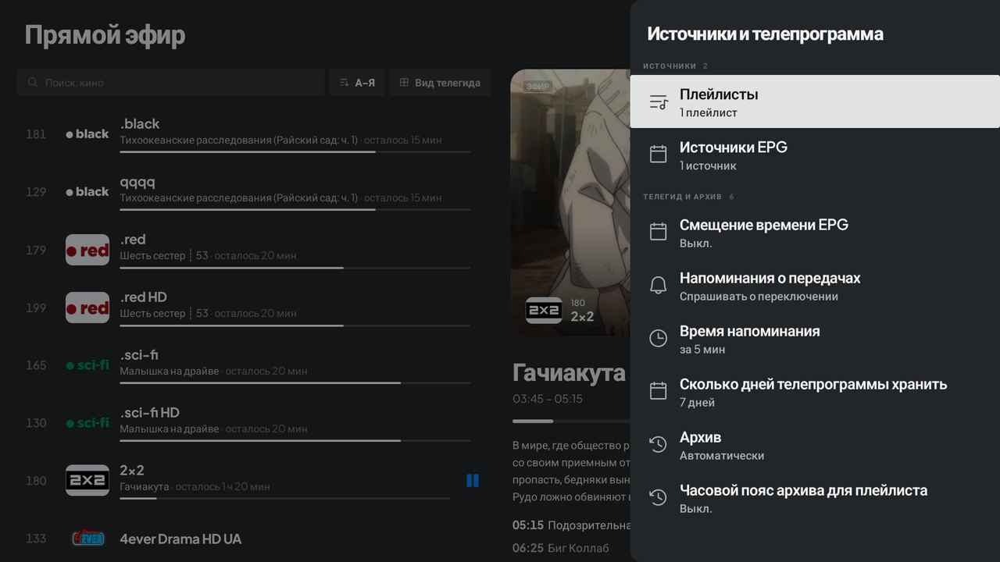 |
| **Settings** — side sheet over live TV | **Sources and TV guide (EPG)**, catch-up |
| 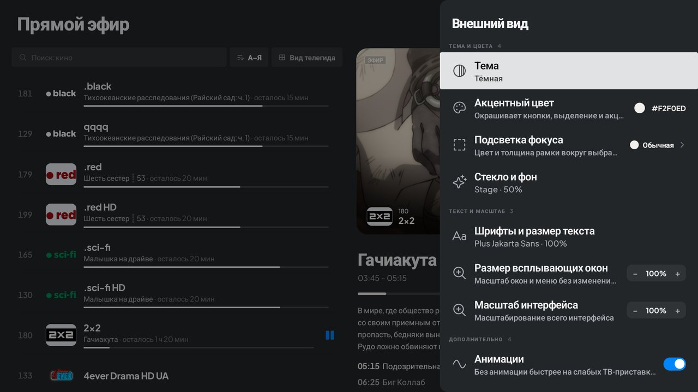 | 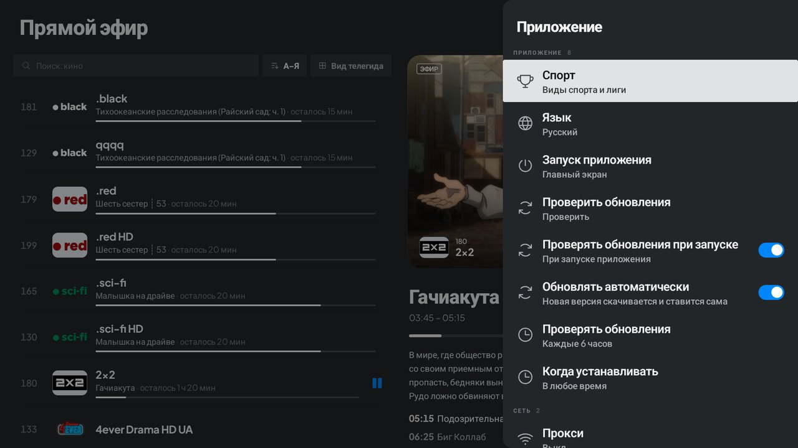 |
| **Appearance**: theme, accent, scale, motion | **System**: language, auto-update, install window |
| 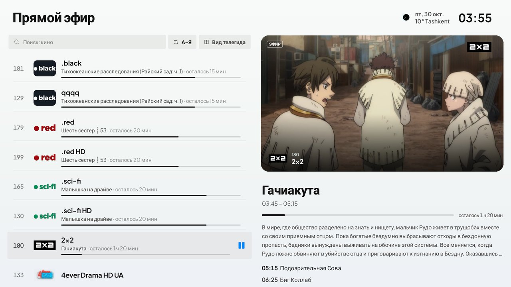 | 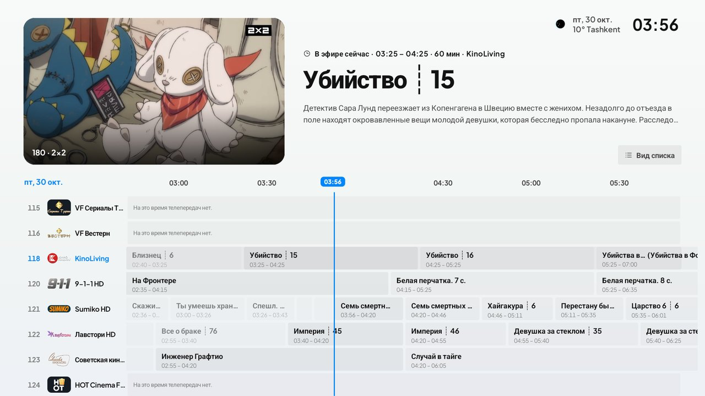 |
| **Light theme** | **TV guide in the light theme** |

## Install

1. Download the latest signed APK:
   **https://github.com/swensi17/skmate-iptv/releases/latest/download/SkMate-IPTV.apk**
2. On a TV, open the link in the **Downloader** app.
3. Allow installs from that source and install the APK.
4. Add a playlist in the app or from your phone via QR code.

Runs on Android TV / Google TV 8.0+, Fire TV and Android set-top boxes (arm64-v8a, armeabi-v7a).

## Security

**v2.2.3 on VirusTotal** (each file fetched by VirusTotal straight from the GitHub release):

| File | Result | Report |
|---|---|---|
| `SkMate-IPTV-Setup-2.2.3.exe` (Windows) | ✅ 0 of 68 | [open](https://www.virustotal.com/gui/file/e6ee399665b8f34d3bccb1faa19768ccd4e7383b434524bcecbbba801573a4cd) |
| `SkMate-IPTV-v2.2.3-arm.apk` (Android TV) | ✅ 0 of 67 | [open](https://www.virustotal.com/gui/file/bf29972ea044d05a6b810e24d433ff06168e0a96c8e9996a45949381cdeef93f) |
| `SkMate-IPTV-v2.2.3-x86_64.apk` | ✅ 0 of 67 | [open](https://www.virustotal.com/gui/file/f39d6c0602dc6ed97f34fe0e8b47b95d9d879ed229a7941c150434c8270de209) |

The TV packages (`.ipk`, `.wgt`, `.zip`) are not fully checked yet (VirusTotal asked for a captcha), so no "0 threats" is claimed for them. The Windows installer has no paid code-signing certificate: SmartScreen says "unknown publisher" on first run (More info → Run anyway), which is not a virus warning.

The v0.1.0 release APK link was checked on [VirusTotal](https://www.virustotal.com/gui/url/05d504ce01ad088e31df5fe963ef495adecafe4fdb005be10bb8738947c0ec53): **0 of 93** scanners flagged anything. The source code is open and builds run in GitHub Actions. SHA-256 checksums are in the release (`SHA256SUMS.txt`):

- arm: `e1041da56c2d1f69f3f7f84d5cd3bd64778a03b5f7b3f708855016cd0d608dcd`
- x86_64: `a9fd75fc7f98c11a6de5051ecad078a66036df0514ddb73a34813df017dbd181`

## Build from source

JDK 21 and Android SDK (platform 37). Everything builds from this repository, no tokens or third-party package registries needed:

```bash
./gradlew :app:assembleStandardDebug
```

In the repository: `app/` (the app), `engine/` (core: playlist parsing, database, players), `libmpv/` (libmpv sources and build scripts), `libs/` (prebuilt libmpv).

## Tech stack

Kotlin · Jetpack Compose for TV · libVLC · Room · Koin · OkHttp · Coroutines/Flow · Coil.

## Content disclaimer

SkMate IPTV is a player only. It does not include or provide channels, playlists or subscriptions. Users are responsible for the sources they add.

## License

[GPL-3.0-or-later](../../LICENSE). Copyright notices: [NOTICE](../../NOTICE). Third-party components: [THIRD_PARTY_LICENSES.md](../../THIRD_PARTY_LICENSES.md).

## Links

[Telegram](https://t.me/swensi17) · [X](https://x.com/swensi17) · [GitHub](https://github.com/swensi17)
