<p align="center">
  <picture>
    <source media="(prefers-color-scheme: dark)" srcset="../../docs/brand/banner-dark.png">
    
  </picture>
</p>

<h1 align="center">SkMate IPTV</h1>

<p align="center"><b>免费、开源的 IPTV 播放器，适用于 Android TV、Google TV 和 Fire TV。</b>Samsung 和 LG 电视版：<a href="https://github.com/swensi17/skmate-tv">SkMate for Smart TV</a>。<br>
支持 M3U 与 Xtream Codes、电视节目单 (EPG)、回看、多用户——专为遥控器设计，无广告，无需账号。</p>

<p align="center">
  <a href="https://github.com/swensi17/skmate-iptv/releases/latest"></a>
  <a href="https://github.com/swensi17/skmate-iptv/releases"></a>
  <a href="https://www.virustotal.com/gui/file/e6ee399665b8f34d3bccb1faa19768ccd4e7383b434524bcecbbba801573a4cd"></a>
  <a href="../../LICENSE"></a>
</p>

<h3 align="center">下载</h3>
<table align="center">
  <tr>
    <td align="center" valign="top" width="33%">
      <a href="https://github.com/swensi17/skmate-iptv/releases/latest/download/SkMate-IPTV.apk"></a><br>
      <sub>Android TV、Google TV、Fire TV<br>APK</sub>
    </td>
    <td align="center" valign="top" width="33%">
      <a href="https://github.com/swensi17/skmate-tv/releases/latest/download/SkMate-IPTV-tizen.wgt"></a><br>
      <sub>三星 Samsung（Tizen），2018 年及以后<br>.wgt</sub>
    </td>
    <td align="center" valign="top" width="33%">
      <a href="https://github.com/swensi17/skmate-tv/releases/latest/download/SkMate-IPTV-webos.ipk"></a><br>
      <sub>LG（webOS）<br>.ipk</sub>
    </td>
  </tr>
</table>
<p align="center"><sub>Android 版像普通应用一样用文件安装。三星和 LG 版通过电视的开发者模式安装：<a href="https://github.com/swensi17/skmate-tv/blob/main/docs/install-samsung.md">三星安装说明</a>（通过 TizenBrew，约 10 分钟），<a href="https://github.com/swensi17/skmate-tv/blob/main/docs/install-lg.md">LG 安装说明</a>（约 15 分钟）。三星和 LG 版本：<a href="https://github.com/swensi17/skmate-tv">swensi17/skmate-tv</a>。</sub></p>


<p align="center">
  
  
  
  <a href="https://github.com/swensi17/skmate-tv"></a>
  <a href="https://github.com/swensi17/skmate-tv"></a>
</p>

<p align="center">
  
  
  
  
  
  
</p>

<p align="center"><a href="../../README.md">Русский</a> · <a href="README.en.md">English</a> · <b>中文</b></p>

<p align="center">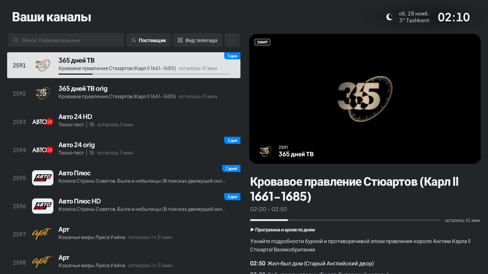</p>

## 功能

**来源**
- 通过链接或文件导入 M3U / M3U8，支持 Xtream Codes、Stalker/Ministra，可同时使用多个播放列表。
- 提供商分组（`group-title`、`#EXTGRP`）、收藏、最近观看、隐藏和重命名分类。
- 在局域网内用手机扫描二维码添加播放列表，无需用遥控器输入。

**电视节目单与回看**
- XMLTV（`url-tvg`、`.xml`、`.xml.gz`），即使没有 `tvg-id` 也能按频道名称自动匹配。
- 所有频道的节目网格，频道列表中直接显示简介和下一个节目。
- 在提供商支持时可回看和直播倒退。

**播放器**
- 单一 **libVLC** 引擎：HLS、MPEG-TS、H.264/HEVC、隔行 576i、MP2/AC-3 音频。
- 频道约 1 秒打开；流中断时静默重连，而不是重启播放器。
- 使用 ▲▼ 和 CH± 换台，频道列表和分类覆盖在画面上，播放不中断。
- 列表中的实时预览，平滑展开为全屏。

**界面**
- 为遥控器设计：方向键和确认键即可完成所有操作，焦点始终清晰可见。
- 深色与浅色主题、强调色、界面缩放、可调动画。
- 多用户、分类 PIN 锁、备份以及电视之间的同步。
- 界面语言：俄语、英语、中文等 20 多种。

**更新**
- 应用会在 GitHub Releases 上发现新版本、校验签名并自动安装。
- 可以关闭；可选择检查频率（启动时 / 每 6 小时 / 每天）和安装时间（任何时间 / 夜间）。

## 截图

### 直播与频道

<table>
<tr>
<td align="center" valign="top" width="50%"><a href="../screenshots/live-dark.jpg"></a><br><b>频道列表</b>: 预览、节目与下一档</td>
<td align="center" valign="top" width="50%"><a href="../screenshots/categories-dark.jpg">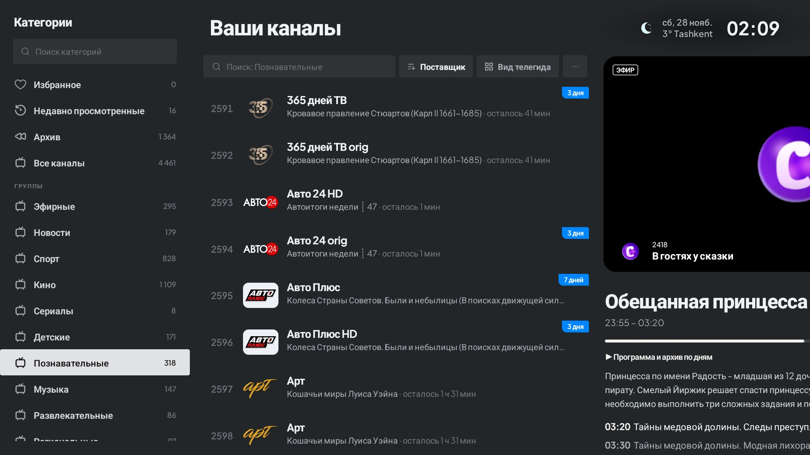</a><br><b>分类</b>: 列表随光标切换</td>
</tr>
</table>

### 节目单与回看

<table>
<tr>
<td align="center" valign="top" width="50%"><a href="../screenshots/archive-dark.jpg">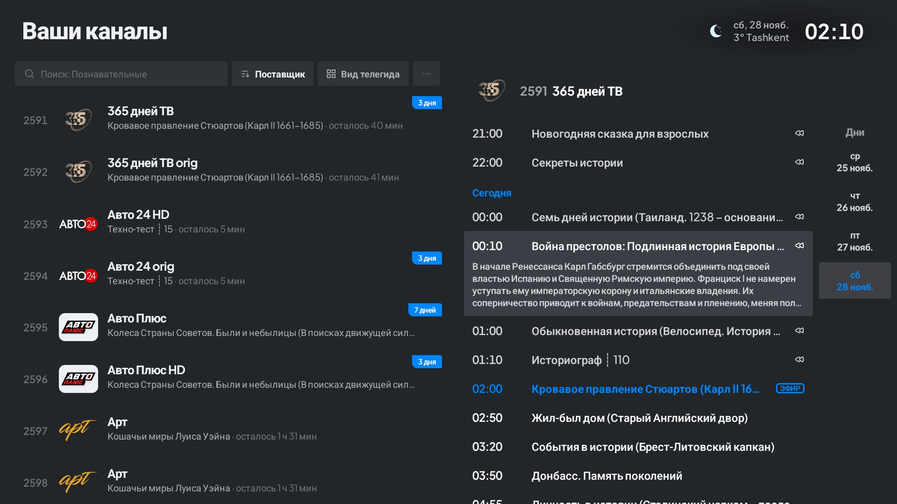</a><br><b>节目与回看</b>: 频道旁的节目栏，右侧选日期</td>
<td align="center" valign="top" width="50%"><a href="../screenshots/guide-dark.jpg">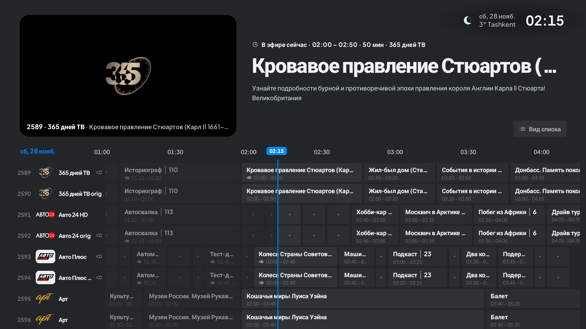</a><br><b>节目单</b>: 全部频道的节目表</td>
</tr>
</table>

### 播放器

<table>
<tr>
<td align="center" valign="top" width="50%"><a href="../screenshots/player-dark.jpg">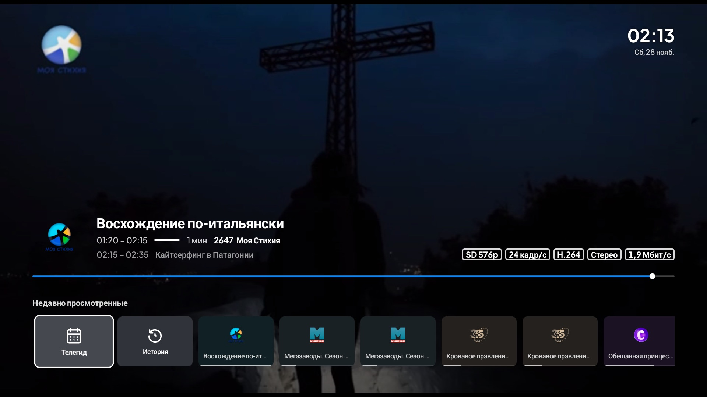</a><br><b>节目信息与最近观看</b>: 节目、画质、最近频道</td>
<td align="center" valign="top" width="50%"><a href="../screenshots/player-channels-dark.jpg">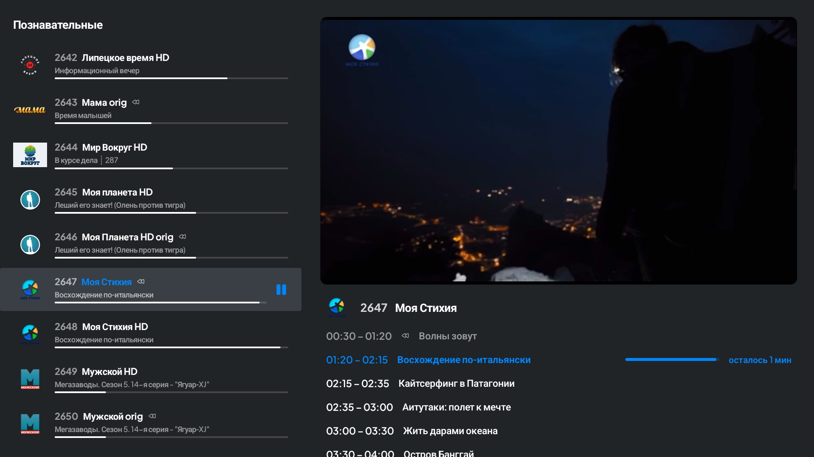</a><br><b>画面上的频道列表</b>: 附带频道节目单</td>
</tr>
<tr>
<td align="center" valign="top" width="100%" colspan="2"><a href="../screenshots/player-categories-dark.jpg">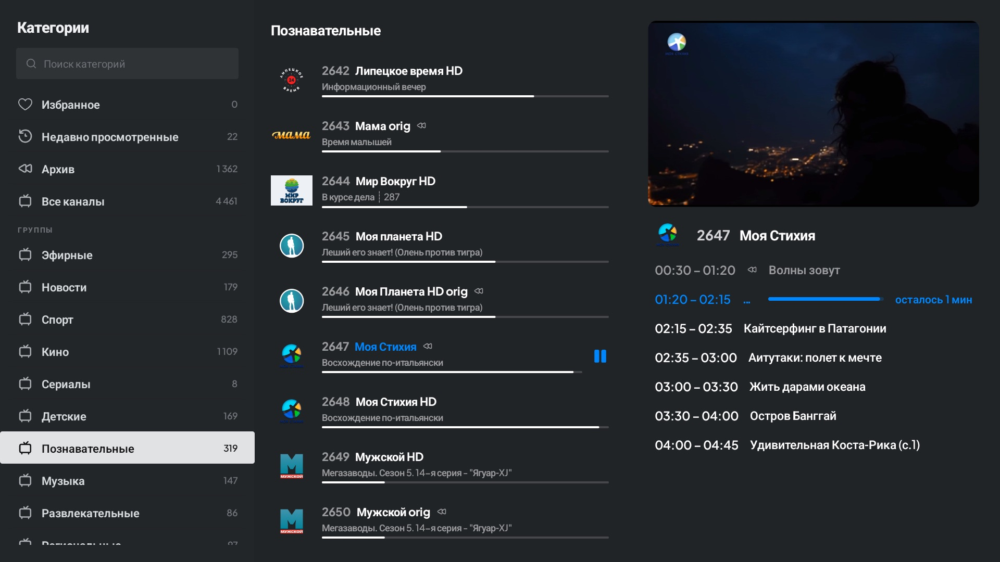</a><br><b>播放中的分类</b>: 画面不中断</td>
</tr>
</table>

### 设置

<table>
<tr>
<td align="center" valign="top" width="50%"><a href="../screenshots/settings-dark.jpg">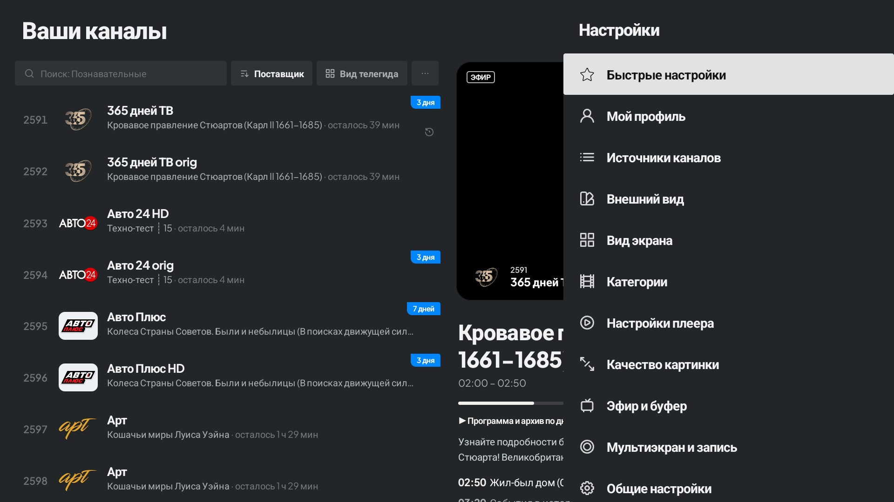</a><br><b>设置</b>: 直播画面上的侧边栏</td>
<td align="center" valign="top" width="50%"><a href="../screenshots/settings-sources-dark.jpg">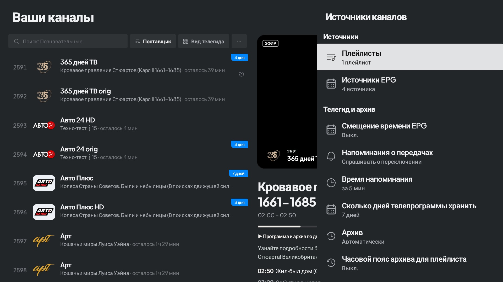</a><br><b>来源与节目单</b>: 播放列表、EPG、回看</td>
</tr>
<tr>
<td align="center" valign="top" width="50%"><a href="../screenshots/settings-player-dark.jpg">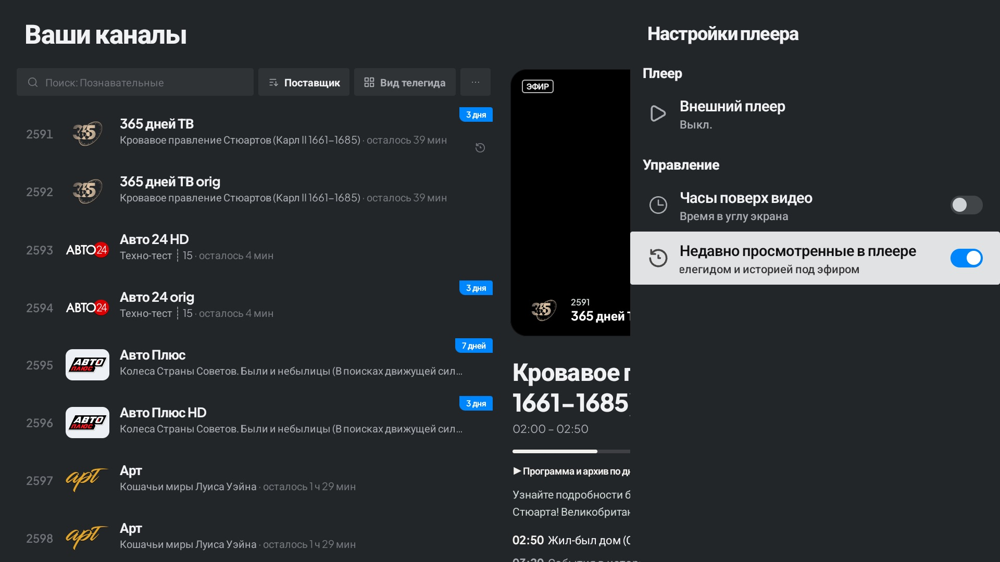</a><br><b>播放器</b>: 时钟与最近观看</td>
<td align="center" valign="top" width="50%"><a href="../screenshots/settings-appearance-dark.jpg">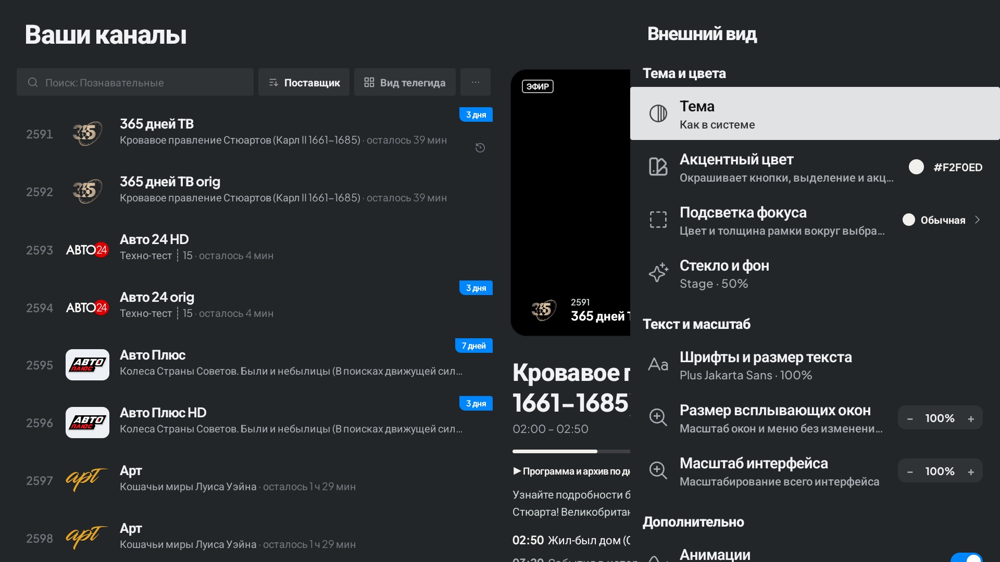</a><br><b>外观</b>: 主题、强调色、缩放</td>
</tr>
</table>

### 浅色主题

<table>
<tr>
<td align="center" valign="top" width="50%"><a href="../screenshots/live-light.jpg">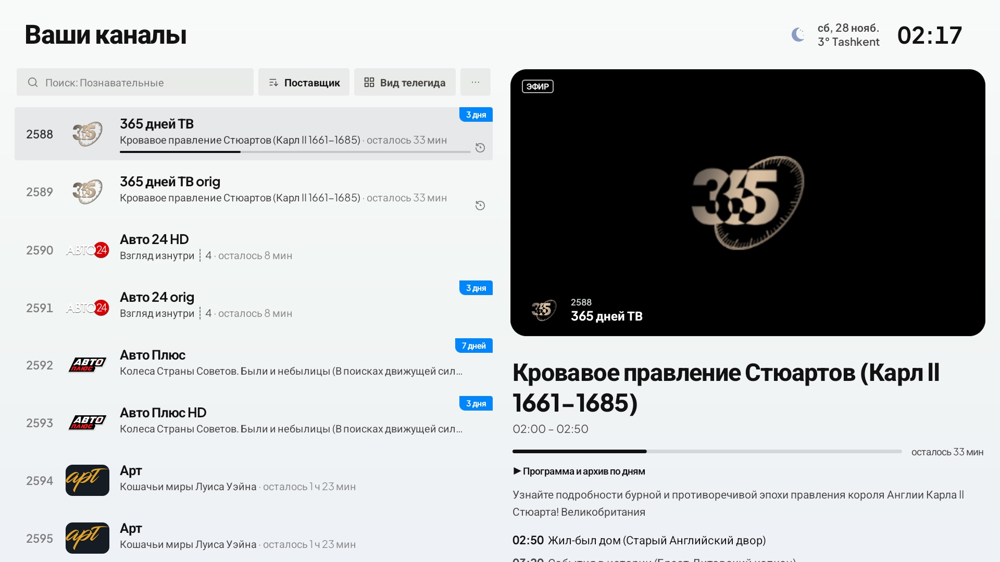</a><br><b>频道列表</b>: 浅色外观</td>
<td align="center" valign="top" width="50%"><a href="../screenshots/settings-appearance-light.jpg">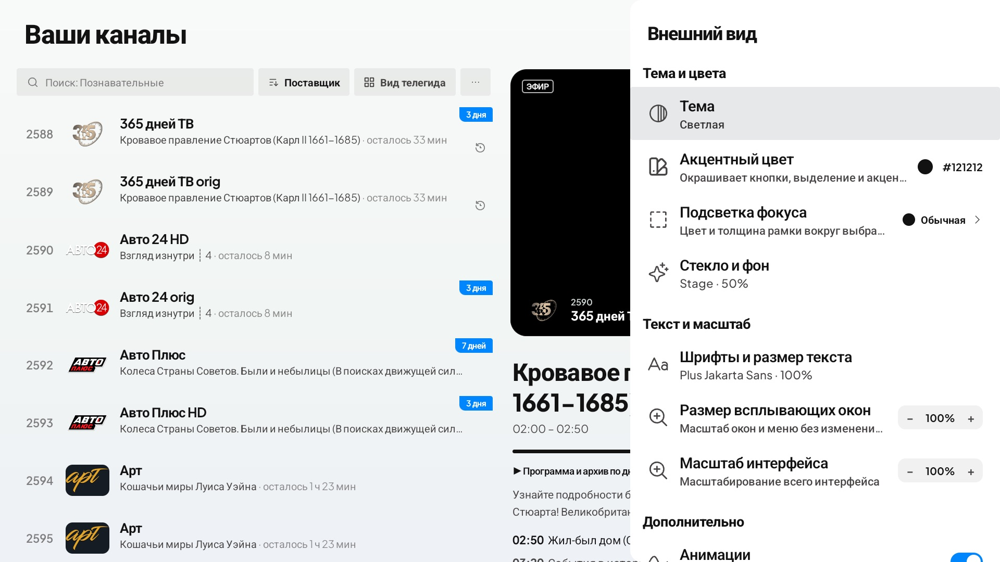</a><br><b>主题选择</b>: 深色、浅色或跟随系统</td>
</tr>
</table>

## 支持的设备

| 设备 | 系统 | 文件 |
|---|---|---|
| Android TV、Google TV 电视和盒子 | Android 8.0 及以上 | [APK](https://github.com/swensi17/skmate-iptv/releases/latest/download/SkMate-IPTV.apk) |
| Amazon Fire TV | Fire OS 6 及以上 | [同一 APK](https://github.com/swensi17/skmate-iptv/releases/latest/download/SkMate-IPTV.apk) |
| 三星智能电视 | Tizen 4.0 及以上 | [.wgt](https://github.com/swensi17/skmate-tv/releases/latest/download/SkMate-IPTV-tizen.wgt) |
| LG 智能电视 | webOS 4.0 及以上 | [.ipk](https://github.com/swensi17/skmate-tv/releases/latest/download/SkMate-IPTV-webos.ipk) |

三星和 LG 版本：[swensi17/skmate-tv](https://github.com/swensi17/skmate-tv)。动态：[频道 @skmates](https://t.me/skmates)，提问：[群组 @skmatetv](https://t.me/skmatetv)。

## 安装

1. 下载最新的签名 APK：
   **https://github.com/swensi17/skmate-iptv/releases/latest/download/SkMate-IPTV.apk**
2. 在电视上用 **Downloader** 应用打开该链接。
3. 允许从该来源安装并安装 APK。
4. 在应用内或用手机扫码添加播放列表。

支持 Android TV / Google TV 8.0+、Fire TV 以及 Android 机顶盒（arm64-v8a、armeabi-v7a）。

## 安全

**v2.2.3 的 VirusTotal 检测**（VirusTotal 直接从 GitHub 发布页下载文件）：

| 文件 | 结果 | 报告 |
|---|---|---|
| `SkMate-IPTV-v2.2.3-arm.apk` (Android TV) | ✅ 67 个中 0 个 | [打开](https://www.virustotal.com/gui/file/bf29972ea044d05a6b810e24d433ff06168e0a96c8e9996a45949381cdeef93f) |
| `SkMate-IPTV-v2.2.3-x86_64.apk` | ✅ 67 个中 0 个 | [打开](https://www.virustotal.com/gui/file/f39d6c0602dc6ed97f34fe0e8b47b95d9d879ed229a7941c150434c8270de209) |

v0.1.0 版本的 APK 链接已在 [VirusTotal](https://www.virustotal.com/gui/url/05d504ce01ad088e31df5fe963ef495adecafe4fdb005be10bb8738947c0ec53) 检测：**93 个**扫描引擎中 **0 个**报告问题。源代码公开，构建在 GitHub Actions 中完成。SHA-256 校验值见发布页 (`SHA256SUMS.txt`)：

- arm: `e1041da56c2d1f69f3f7f84d5cd3bd64778a03b5f7b3f708855016cd0d608dcd`
- x86_64: `a9fd75fc7f98c11a6de5051ecad078a66036df0514ddb73a34813df017dbd181`

## 从源码构建

需要 JDK 21 和 Android SDK（platform 37）。全部从本仓库构建，不需要令牌或第三方包仓库：

```bash
./gradlew :app:assembleStandardDebug
```

仓库结构：`app/`（应用）、`engine/`（核心：播放列表解析、数据库、播放器）、`libmpv/`（libmpv 源码与构建脚本）、`libs/`（预编译 libmpv）。

## 技术栈

Kotlin · Jetpack Compose for TV · libVLC · Room · Koin · OkHttp · Coroutines/Flow · Coil。

## 内容声明

SkMate IPTV 只是播放器，不包含也不提供任何频道、播放列表或订阅。用户需自行对所添加的来源负责。

## 许可证

[GPL-3.0-or-later](../../LICENSE)。版权声明见 [NOTICE](../../NOTICE)，第三方组件见 [THIRD_PARTY_LICENSES.md](../../THIRD_PARTY_LICENSES.md)。

## 链接

[Telegram](https://t.me/swensi17) · [X](https://x.com/swensi17) · [GitHub](https://github.com/swensi17)
