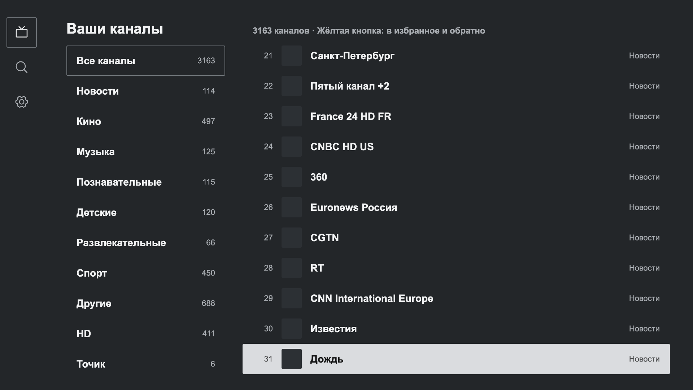
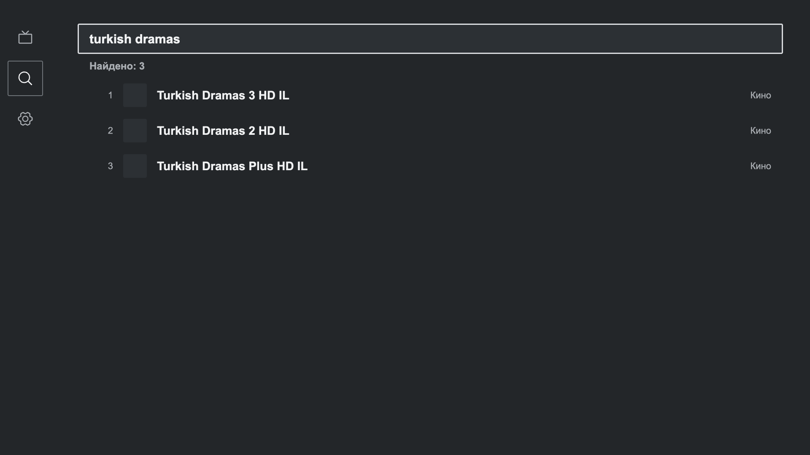
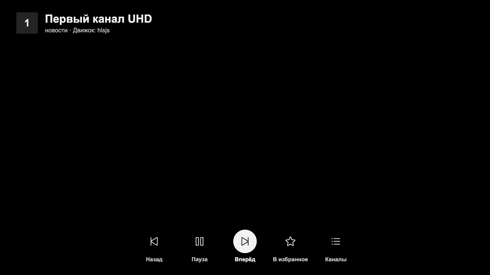
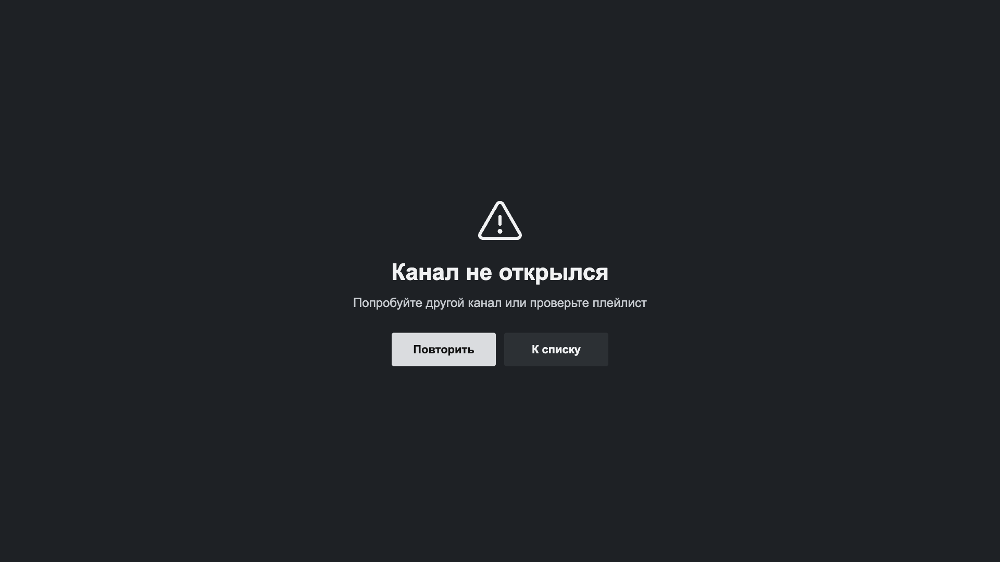

# SkMate IPTV для LG webOS и Samsung Tizen

Веб-версия плеера для телевизоров LG и Samsung. Живёт в одном репозитории с Android-приложением, но полностью отдельно: свои пакеты, свои тесты, своя сборка. Дизайн, цвета, форма фокуса и логика поиска те же, что в Android.

**Демо:** [swensi17.github.io/skmate-iptv](https://swensi17.github.io/skmate-iptv/) — та же сборка, что ставится на телевизор. Стрелки = пульт, Enter = OK, Esc = «Назад». В демо встроенный демо-плейлист с открытыми тестовыми потоками; свой плейлист добавляется в настройках. Телегид из чужих серверов в браузере может не загрузиться без прокси (их серверы не отдают CORS), на телевизоре такого ограничения нет.


| Настройки, тёмная | Настройки, светлая | Поиск в неверной раскладке |
|---|---|---|
|  |  |  |

Плейлисты, избранное и понятные ошибки:

| Пусто | Избранное | Плейлисты | Удаление | Ошибка ссылки |
|---|---|---|---|---|
|  |  |  |  |  |

Реальный плейлист на 3163 канала, плеер и ошибка воспроизведения:

| Список | Поиск | Плеер | Ошибка |
|---|---|---|---|
|  |  |  |  |

## Устройство

Один обработчик пульта, никаких монолитов: каждый пакет делает одно дело и не знает про соседей сверх своего интерфейса.

| Пакет | Что внутри |
|---|---|
| `packages/core` | M3U-парсер и умный поиск (раскладки, транслит, опечатки). Порт `SmartSearch.kt`, тесты те же |
| `packages/player` | Интерфейс движка, лестница запасных вариантов (родной декодер ТВ, затем hls.js), без привязки к экрану |
| `packages/ui` | Токены дизайна, геометрическая навигация D-pad, адаптивные анимации, иконки Phosphor |
| `apps/tv` | Само приложение: экраны, строки (ru, en), настройки, пакеты webOS и Tizen |

Поддерживаются Chromium 53+ (webOS 4, Tizen 4): рядом с современным бандлом собирается старый. hls.js подгружается только когда родной декодер не справился.

## Команды

```bash
cd web
npm ci
npm run dev      # http://localhost:5173, 1920×1080
npm run check    # типы и тесты
npm run build    # apps/tv/dist
```

Проверка перед пушем (вместе с Android): `scripts/pre-push-check.sh`.

## Установка на телевизор

Каждый выпуск на [странице релизов](https://github.com/swensi17/skmate-iptv/releases/latest) несёт три файла веб-версии (собираются `npm run build && npm run package` и `ares-package`):

| Файл | Куда | Как поставить |
|---|---|---|
| `SkMate-IPTV-web-vX.Y.Z.zip` | любой веб-сервер, NAS, свой хостинг | распаковать и открыть `index.html` по адресу сервера |
| `uz.skmate.iptv_X.Y.Z_all.ipk` | LG webOS 4+ | телевизор в Developer Mode, затем `ares-install uz.skmate.iptv_X.Y.Z_all.ipk` |
| `SkMate-IPTV-tizen-vX.Y.Z.wgt` | Samsung Tizen 4+ | пакет без подписи: подписать своим сертификатом Samsung в Tizen Studio (`tizen package -t wgt -s <профиль>`), затем `tizen install` на телевизор в режиме разработчика |

Samsung и LG не дают ставить приложения в обход своих магазинов без режима разработчика, поэтому для обычного зрителя удобнее демо-адрес или свой веб-сервер: там работает и обновление по `version.json`.

## Обновления

Сборка кладёт рядом с приложением `version.json` (версия и время сборки). Работающее приложение читает его через 4 секунды после запуска и каждые 6 часов, и если на сервере версия новее, предлагает обновиться.

- **Автообновление выключено (по умолчанию):** при каждом запуске окно «Доступно обновление» с кнопками «Установить» и «Позже». «Позже» откладывает до следующего запуска.
- **Автообновление включено** (Настройки, Система): новая версия ставится сама, когда ничего не играет. Идущий канал не прерывается.
- **Установка** чистит кэши браузера (Cache API, service worker) и перезагружает страницу под новым адресом `?v=<сборка>`. Плейлисты, избранное, профили и настройки лежат в localStorage и не трогаются; в старом файле настроек новые поля берут значения по умолчанию. Если кэш телевизора всё равно отдал старую страницу, повторной перезагрузки в цикле нет: в настройках будет подсказка перезапустить приложение.
- **Ограничение:** обновление работает, когда приложение загружается с веб-сервера (так делают hosted-приложения webOS и Tizen). Установленный из пакета `.ipk` / `.wgt` лежит на телевизоре целиком, его заменяет только новая установка; проверка там тихо ничего не находит.

## Нагрузочные тесты

`apps/tv/src/stress/load.test.ts` (входит в `npm test`) гоняет плейлист на 150 000 каналов (разбор, группы, поиск с опечатками и неверной раскладкой, зеркала), телегид на неделю в gzip кусками по 64 КБ (сопоставление, окно, бюджет хранилища, самая долгая пауза без свободного момента для экрана), десять плейлистов с резервной копией и повреждённые телегиды (обрыв, не gzip, пустой, HTML, 500). Цифры печатаются в вывод, пределы заведомо шире, чем нужно настольному компьютеру: тест ловит квадратичные замедления, а телевизор в несколько раз медленнее.

## Что готово и что дальше

Готово: оболочка; боковое меню (каналы, телегид, спорт, поиск, настройки); группы и каналы в виртуальном списке с тонкими линиями; предпросмотр; поиск (раскладки, транслит, опечатки); три движка (родной декодер ТВ, hls.js, mpegts.js для сырых `.ts`) со сменой по порядку; зеркала каналов (если канал не открылся, играет его копия, алгоритм из Android); самовосстановление hls.js; свои плейлисты и быстрая смена из экрана каналов; телегид (см. ниже); избранное; история просмотра («Недавние»), группа «Архив» по данным провайдера (воспроизведение архива не подключено), настройки шторкой справа по разделам (плеер, оформление, плейлисты, телегид, профили, система, резервная копия, о приложении со ссылками и QR), настройка размера строк, значков, номеров и передачи в списке; профили и гость с приветствием при первом входе (у каждого свои плейлисты, избранное и телегид); тема по системе; адаптивные анимации; ru и en.

Дальше: история просмотра, запись, мультивид, архив, PIN-код профиля, резервная копия, зеркала каналов, сортировка и подборки, пакеты `.ipk` и `.wgt`, проверка на настоящих телевизорах (там воспроизводит родной декодер ТВ, hls.js только запасной).

Ограничение веба: браузер не отдаёт плейлисты с серверов без заголовков CORS. На телевизоре такие плейлисты откроются через небольшой прокси, это следующий шаг.
