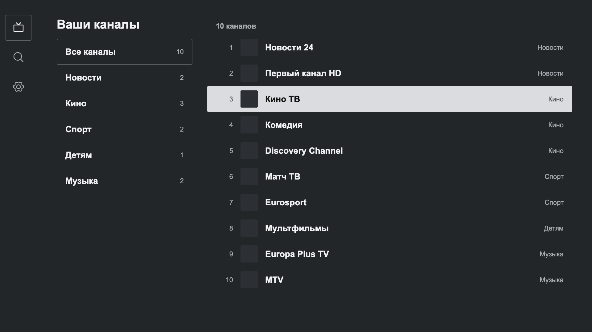
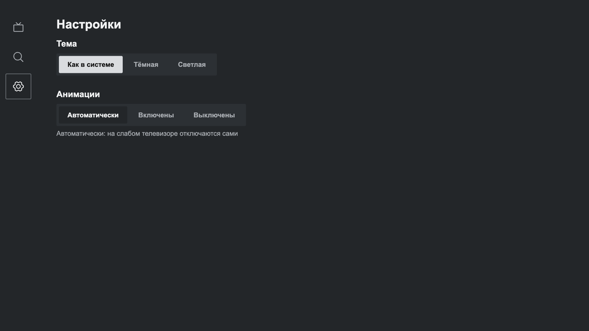
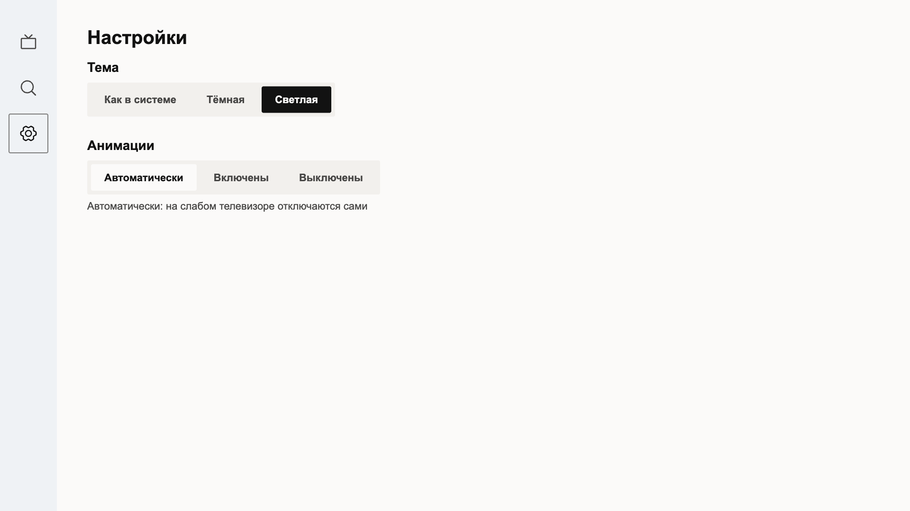
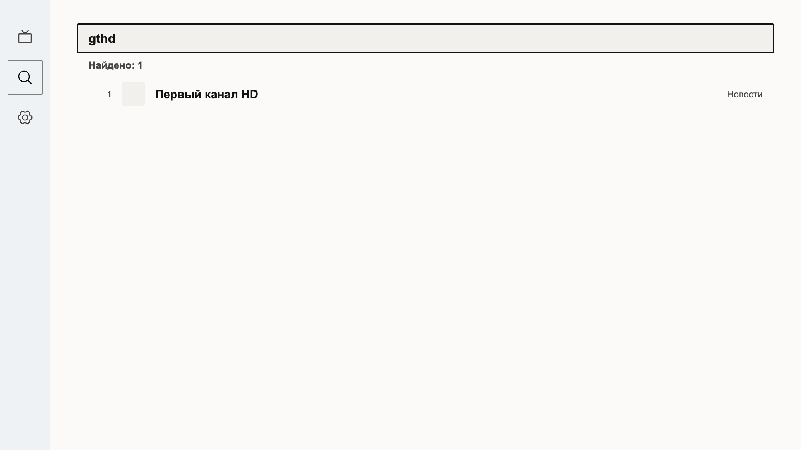
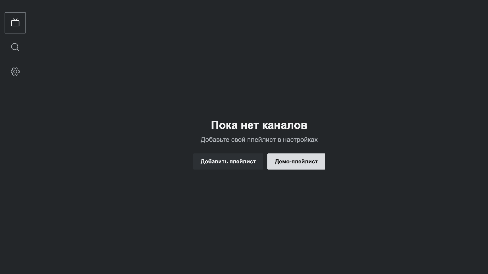
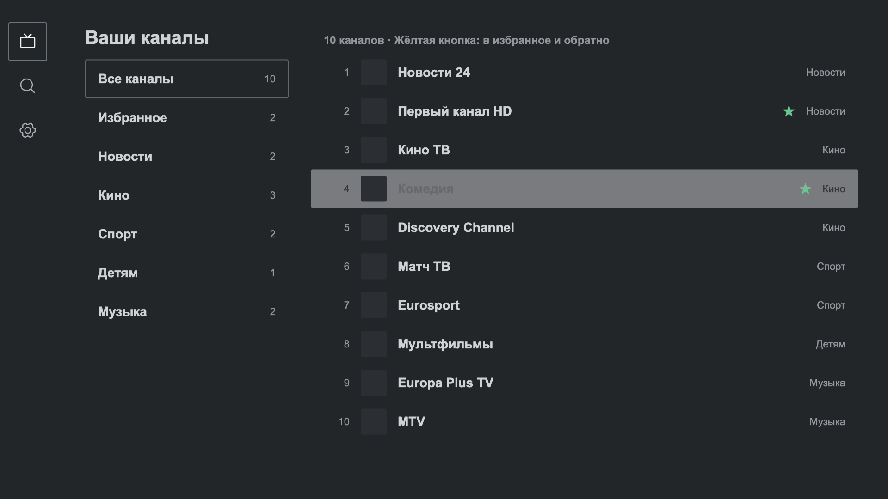
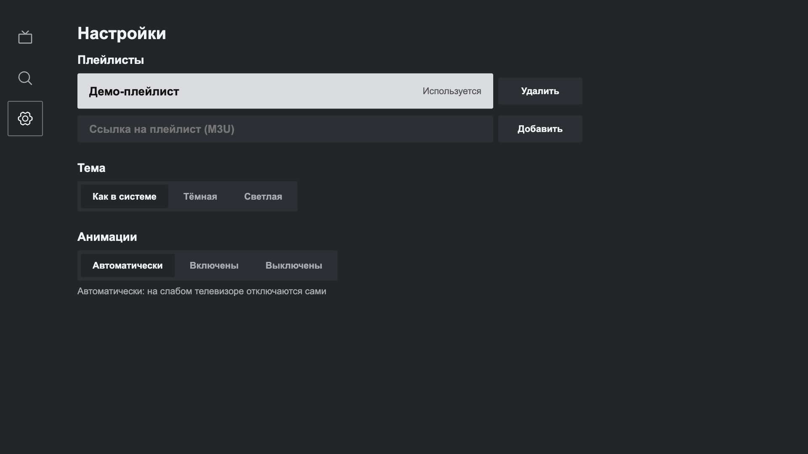
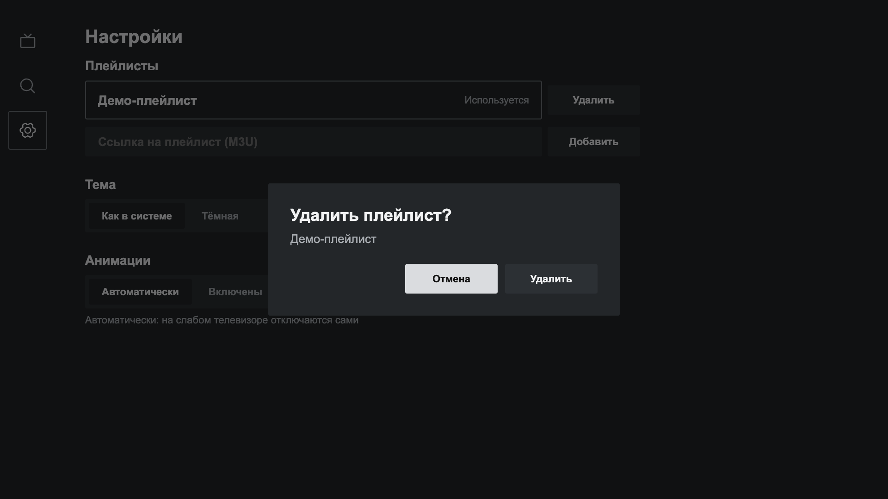
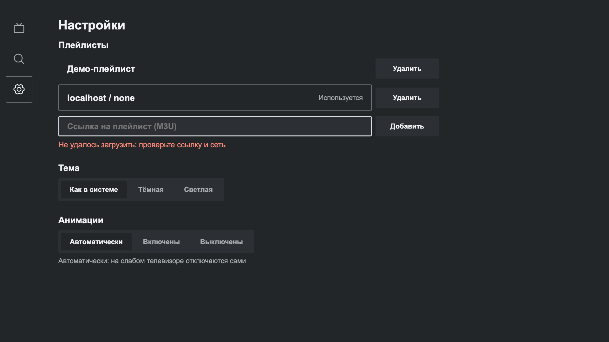

# SkMate IPTV для LG webOS и Samsung Tizen

Веб-версия плеера для телевизоров LG и Samsung. Живёт в одном репозитории с Android-приложением, но полностью отдельно: свои пакеты, свои тесты, своя сборка. Дизайн, цвета, форма фокуса и логика поиска те же, что в Android.



| Настройки, тёмная | Настройки, светлая | Поиск в неверной раскладке |
|---|---|---|
|  |  |  |

Плейлисты, избранное и понятные ошибки:

| Пусто | Избранное | Плейлисты | Удаление | Ошибка ссылки |
|---|---|---|---|---|
|  |  |  |  |  |

## Устройство

Один обработчик пульта, никаких монолитов: каждый пакет делает одно дело и не знает про соседей сверх своего интерфейса.

| Пакет | Что внутри |
|---|---|
| `packages/core` | M3U-парсер и умный поиск (раскладки, транслит, опечатки). Порт `SmartSearch.kt`, тесты те же |
| `packages/player` | Интерфейс движка, лестница запасных вариантов (родной декодер ТВ, затем hls.js), без привязки к экрану |
| `packages/ui` | Токены дизайна, геометрическая навигация D-pad, адаптивные анимации, иконки Phosphor |
| `apps/tv` | Само приложение: экраны, строки (ru, en), настройки, пакеты webOS и Tizen |

Поддерживаются Chromium 53+ (webOS 4, Tizen 4): рядом с современным бандлом собирается старый. hls.js подгружается только когда родной декодер не справился.

## Команды

```bash
cd web
npm ci
npm run dev      # http://localhost:5173, 1920×1080
npm run check    # типы и тесты
npm run build    # apps/tv/dist
```

Проверка перед пушем (вместе с Android): `scripts/pre-push-check.sh`.

## Что готово и что дальше

Готово: оболочка, меню значками, список каналов по группам, поиск (раскладки, транслит, опечатки), плеер с лестницей движков, свои плейлисты по ссылке (кэш последней копии, понятные ошибки), избранное жёлтой кнопкой, подтверждение удаления, тема по системе, адаптивные анимации, ru и en.

Дальше: телегид (XMLTV), история просмотра, зеркала каналов, сортировка и подборки, пакеты `.ipk` и `.wgt`, проверка на настоящих телевизорах.

Ограничение веба: браузер не отдаёт плейлисты с серверов без заголовков CORS. На телевизоре такие плейлисты откроются через небольшой прокси, это следующий шаг.
